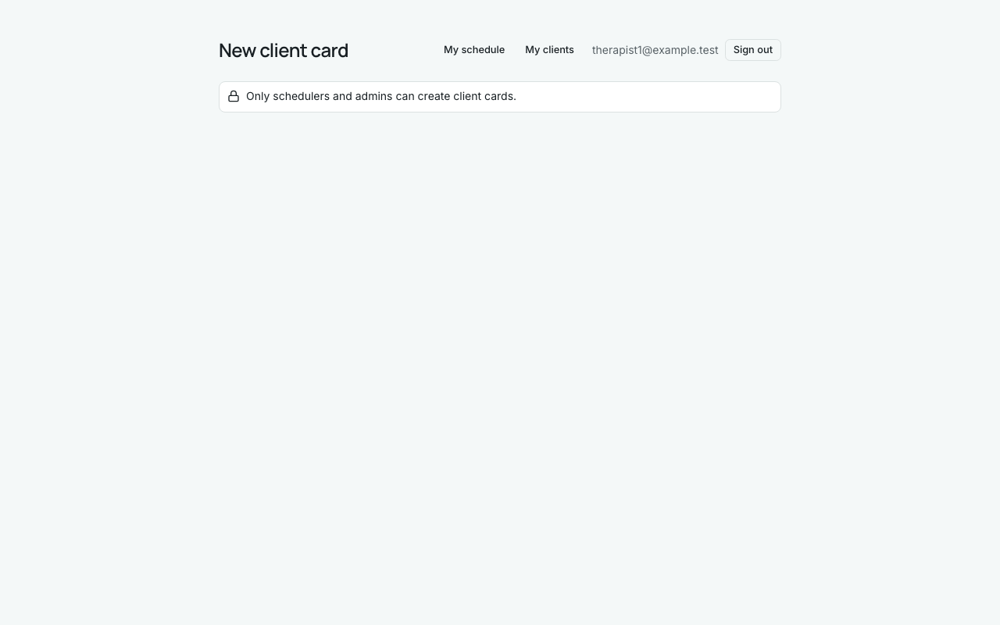
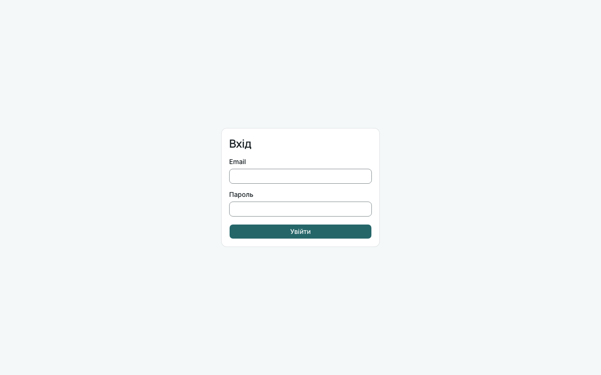
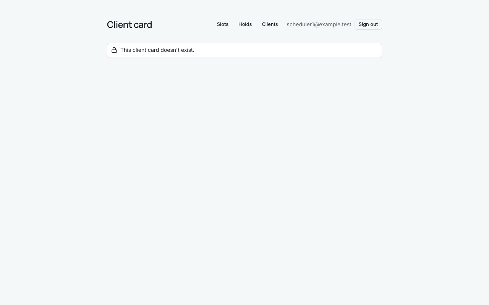
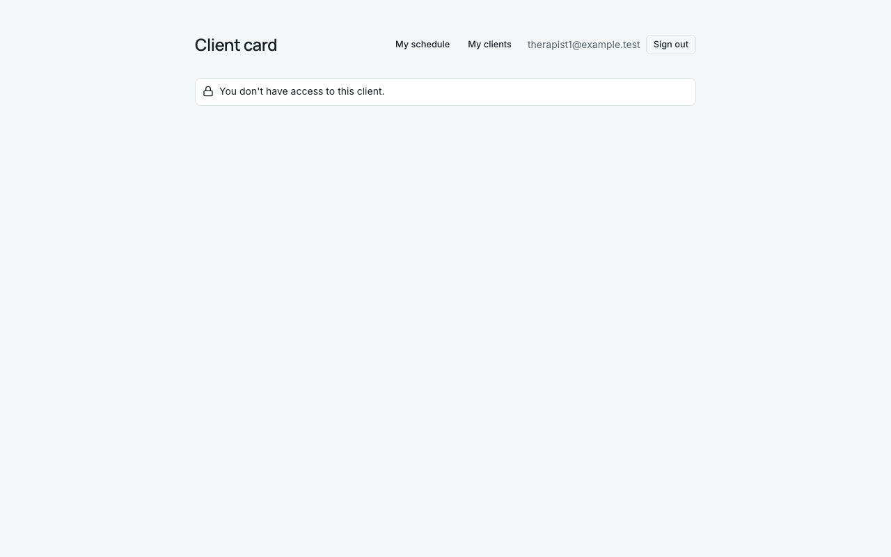

# Звіт UAT — 02.11.2026

- **Застосунок:** https://therapy-scheduling-three.vercel.app (/api/health: коміт `8d2fec6`)
- **Код тестів:** `task/uat` @ `9cc6f9e`
- **Прогін:** 02.11.2026, 12:41 (Київ), Playwright 28.3 с; AC: 3 — PASS 3, FAIL 0, NEEDS-HUMAN 0
- **Рецензент:** `claude-haiku-5-5`; суперечки → `claude-sonnet-5-5`. Разом за розбір: $0.0077 (ціни API; за підпискою — у межах ліміту плану)
- **Прибирання:** синтетичних uat-*@example.test видалено 0, лишилось 0, їхніх рядків, що лишились: 0
- **Відео й траси:** не в git — `test-results/` локально або артефакт CI; трасу відкриває `npx playwright show-trace <trace.zip>`

| AC | Перевірки | Агент | Підсумок | Чому | Playwright | Розбір |
|---|---|---|---|---|---|---|
| AC-CARD-06 | пройшли | Haiku: PASS | **PASS** | R6: перевірки, агент і цитати збігаються | 7.1 с | $0.0022, 10.3 с |
| AC-CARD-07 | пройшли | Haiku: PASS | **PASS** | R6: перевірки, агент і цитати збігаються | 9.3 с | $0.0030, 10.6 с |
| AC-CARD-16 | пройшли | Haiku: PASS | **PASS** | R6: перевірки, агент і цитати збігаються | 3.2 с | $0.0025, 8.8 с |

## AC-CARD-06 — PASS

**Тест:** AC-CARD-06: терапевт за прямим посиланням на нову картку бачить лише відмову, кількість карток не змінилась

**Критерій** (requirements/19-planuvalnyk-zapovniuie-kartku-kliienta.md):

> AC-CARD-06: Дано therapist1 увійшов у застосунок. Коли він відкриває форму нової картки клієнта за прямим посиланням. Тоді форму не показано, therapist1 одразу бачить повідомлення «Only schedulers and admins can create client cards.», і кількість карток клієнтів не змінилася.

**Кроки:** ✔ Дано: therapist1 увійшов у застосунок → ✔ Коли: він відкриває форму нової картки клієнта за прямим посиланням → ✔ Тоді: форму не показано, therapist1 одразу бачить повідомлення «Only schedulers and admins can create client cards.», і кількість карток клієнтів не змінилася

**Агент (claude-haiku-5-5, PASS):** На кадрі сторінки «New client card» під шапкою видно один рядок із замком: «Only schedulers and admins can create client cards.», текст збігається з критерієм посимвольно. Полів анкети та кнопки створення на кадрі немає, тому частину про відсутність форми визнано виконаною; цитати для неї немає, бо це відсутність елементів, а не текст.

**Цитати агента, звірені зі сторінкою (aria):**
- «Only schedulers and admins can create client cards.» — є на сторінці

**Правило:** R6: перевірки, агент і цитати збігаються

**Відео:** `test-results/artifacts/client-cards-терапевт-AC-C-7cc32-лькість-карток-не-змінилась-chromium/video.webm` · **траса:** `test-results/artifacts/client-cards-терапевт-AC-C-7cc32-лькість-карток-не-змінилась-chromium/trace.zip` (не в git)

**Рішення PM:** ☐ приймаю · ☐ відхилення від вимог (issue «Відхилення від вимог: AC-CARD-06 — …») · @login: ____

## AC-CARD-07 — PASS

**Тест:** AC-CARD-07: без входу за прямим посиланням на клієнтів, картку client6 чи утримання — лише сторінка входу

**Критерій** (requirements/19-planuvalnyk-zapovniuie-kartku-kliienta.md):

> AC-CARD-07: Дано користувач не увійшов у застосунок. Коли він відкриває за прямим посиланням список клієнтів, картку client6 або список утримань. Тоді він бачить лише сторінку входу, жодних даних клієнтів чи утримань не показано, і жодна картка не змінилася.

**Кроки:** ✔ Дано: користувач не увійшов у застосунок → ✔ Коли: він відкриває за прямим посиланням список клієнтів → ✔ Тоді: він бачить лише сторінку входу, жодних даних клієнтів чи утримань не показано → ✔ Коли: він відкриває за прямим посиланням картку client6 → ✔ Тоді: він бачить лише сторінку входу, жодних даних клієнтів чи утримань не показано → ✔ Коли: він відкриває за прямим посиланням список утримань → ✔ Тоді: він бачить лише сторінку входу, жодних даних клієнтів чи утримань не показано, і жодна картка не змінилася

**Агент (claude-haiku-5-5, PASS):** На всіх трьох кадрах (frame-then-1, -2, -3) видно лише сторінку входу з заголовком «Вхід», полями Email і Пароль та кнопкою «Увійти»; жодних карток клієнтів чи утримань на кадрах немає. Частину «жодна картка не змінилася» і адресу /login кадри не підтверджують, тому це не оцінювалося.

**Цитати агента, звірені зі сторінкою (aria):**
- «Вхід» — є на сторінці
- «Email» — є на сторінці
- «Пароль» — є на сторінці
- «Вхід» — є на сторінці
- «Email» — є на сторінці
- «Пароль» — є на сторінці
- «Вхід» — є на сторінці
- «Email» — є на сторінці
- «Пароль» — є на сторінці
- «Вхід» — є на сторінці
- «Email» — є на сторінці
- «Пароль» — є на сторінці
- «Вхід» — є на сторінці
- «Email» — є на сторінці
- «Пароль» — є на сторінці
- «Вхід» — є на сторінці
- «Email» — є на сторінці
- «Пароль» — є на сторінці

**Правило:** R6: перевірки, агент і цитати збігаються

**Відео:** `test-results/artifacts/client-cards-без-входу-AC--66889-мання-—-лише-сторінка-входу-chromium/video.webm` · **траса:** `test-results/artifacts/client-cards-без-входу-AC--66889-мання-—-лише-сторінка-входу-chromium/trace.zip` (не в git)

**Рішення PM:** ☐ приймаю · ☐ відхилення від вимог (issue «Відхилення від вимог: AC-CARD-07 — …») · @login: ____

## AC-CARD-16 — PASS

**Тест:** AC-CARD-16: посилання на картку, якої немає — scheduler1 бачить «This client card doesn't exist.», therapist1 — «You don't have access to this client.»

**Критерій** (requirements/19-planuvalnyk-zapovniuie-kartku-kliienta.md):

> AC-CARD-16: Дано картки клієнта, на яку веде посилання, не існує. Коли scheduler1, а потім therapist1 відкриває це посилання. Тоді scheduler1 бачить повідомлення «This client card doesn't exist.», therapist1 — «You don't have access to this client.», і жоден із них не бачить жодних даних клієнтів.

**Кроки:** ✔ Дано: картки клієнта, на яку веде посилання, не існує → ✔ Коли: scheduler1 відкриває це посилання → ✔ Тоді: scheduler1 бачить повідомлення «This client card doesn't exist.» → ✔ Коли: потім therapist1 відкриває це посилання → ✔ Тоді: therapist1 — «You don't have access to this client.», і жоден із них не бачить жодних даних клієнтів

**Агент (claude-haiku-5-5, PASS):** На frame-then-1.png (scheduler1) посередині сторінки відображено «This client card doesn't exist.», а на frame-then-2.png (therapist1) — «You don't have access to this client.». Обидва тексти збігаються з критерієм посимвольно. На обох кадрах немає жодних полів картки клієнта: видно лише заголовок «Client card», навігацію та email поточного користувача у шапці.

**Цитати агента, звірені зі сторінкою (aria):**
- «This client card doesn't exist.» — є на сторінці
- «Client card» — є на сторінці
- «You don't have access to this client.» — є на сторінці
- «Client card» — є на сторінці

**Правило:** R6: перевірки, агент і цитати збігаються

**Відео:** `test-results/artifacts/client-cards-планувальник--08582-ave-access-to-this-client-»-chromium/video.webm` · **траса:** `test-results/artifacts/client-cards-планувальник--08582-ave-access-to-this-client-»-chromium/trace.zip` (не в git)

**Рішення PM:** ☐ приймаю · ☐ відхилення від вимог (issue «Відхилення від вимог: AC-CARD-16 — …») · @login: ____

## Як читати підсумок

- **PASS** — автоматичні перевірки пройшли, агент-рецензент погодився з кадром, а кожну його цитату знайдено на сторінці.
- **FAIL** — впала автоматична перевірка. Агент цього не перекриває: невидимі вади (буфер обміну, база) він на кадрі не побачить.
- **NEEDS-HUMAN** — перевірки зелені, але агент не погодився або його цитати немає на сторінці. Часто це слабкий тест або розбіжність між текстом AC і тестом — питання до PM, а не обов'язково вада продукту.

Правила: R1: перевірка впала — FAIL завжди, агент не перекриває; R2: немає вердикту агента або кадру; R3: перевірки пройшли, агент не погоджується — вирішує людина; R4: цитати агента немає на сторінці (aria) — не підтверджено; R5: помилка сторінки або 5xx під час сценарію; R6: перевірки, агент і цитати збігаються.
