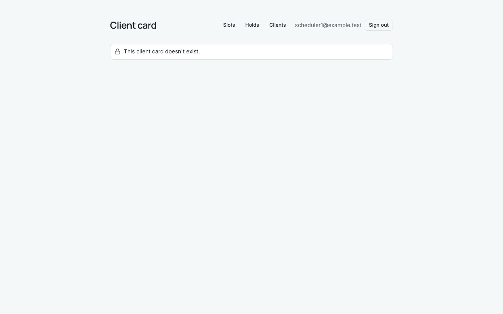

# Звіт UAT — 09.11.2026

- **Застосунок:** https://therapy-scheduling-three.vercel.app (/api/health: коміт `d5647b3`)
- **Код тестів:** `task/insurance-followups` @ `68b54c1` + незакомічені зміни
- **Прогін:** 09.11.2026, 18:38 (Київ), Playwright 18.3 с; AC: 0 — PASS 0, FAIL 0, NEEDS-HUMAN 0; негативних контролів: 2
- **Рецензент:** `claude-haiku-5-5`; суперечки → `claude-sonnet-5-5`. Разом за розбір: $0.0344 (ціни API; за підпискою — у межах ліміту плану)
- **Прибирання:** синтетичних uat-*@example.test видалено 0, лишилось 0, їхніх рядків, що лишились: 0
- **Відео й траси:** не в git — `test-results/` локально або артефакт CI; трасу відкриває `npx playwright show-trace <trace.zip>`

| AC | Перевірки | Агент | Підсумок | Чому | Playwright | Розбір |
|---|---|---|---|---|---|---|
| NC-1 (AC-CARD-16) | впали | Haiku: PASS | **FAIL** | R1: перевірка впала — FAIL завжди, агент не перекриває | 6.5 с | $0.0019, 7.4 с |
| NC-2 (AC-CARD-16) | пройшли | Haiku: FAIL, Sonnet: FAIL | **NEEDS-HUMAN** | R3: перевірки пройшли, агент не погоджується — вирішує людина | 1.7 с | $0.0325, 17.3 с |

## NC-1 — негативний контроль для AC-CARD-16 — FAIL

**Тест:** NC-1 (AC-CARD-16, навмисно хибне очікування в тесті: інший текст повідомлення)

**Критерій** (requirements/19-planuvalnyk-zapovniuie-kartku-kliienta.md):

> AC-CARD-16: Дано картки клієнта, на яку веде посилання, не існує. Коли scheduler1, а потім therapist1 відкриває це посилання. Тоді scheduler1 бачить повідомлення «This client card doesn't exist.», therapist1 — «You don't have access to this client.», і жоден із них не бачить жодних даних клієнтів.



**Кроки:** ✔ Дано: картки клієнта, на яку веде посилання, не існує → ✔ Коли: scheduler1 відкриває це посилання → ✘ Тоді: scheduler1 бачить повідомлення «This client card doesn't exist.»

**Перевірка впала:**

```
Error: expect(locator).toHaveText(expected) failed

Locator:  getByRole('main').getByRole('alert')
Expected: "This client card was not found."
Received: "This client card doesn't exist."
Timeout:  5000ms

Call log:
```

**Агент (claude-haiku-5-5, PASS):** На кадрі frame-then-1.png для scheduler1 (сторінка /clients/00000000-0000-4000-8000-000000000016) видно повідомлення «This client card doesn't exist.» з піктограмою замка; жодних даних клієнта на екрані немає. Частина для therapist1 («You don't have access to this client.») у переліку видимих частин ac.md не зазначена і цим кадром не покрита, тож її я не оцінював.

**Цитати агента, звірені зі сторінкою (aria):**
- «This client card doesn't exist.» — є на сторінці

**Правило:** R1: перевірка впала — FAIL завжди, агент не перекриває

**Відео:** `test-results/artifacts/negative-controls-NC-1-AC--6ed84-і-інший-текст-повідомлення--negative-controls/video.webm` · **траса:** `test-results/artifacts/negative-controls-NC-1-AC--6ed84-і-інший-текст-повідомлення--negative-controls/trace.zip` (не в git)

_Негативний контроль: навмисно хибне очікування. Очікуваний підсумок — FAIL або NEEDS-HUMAN, не PASS._

## NC-2 — негативний контроль для AC-CARD-16 — NEEDS-HUMAN

**Тест:** NC-2 (AC-CARD-16, текст «Тоді» у вимозі уточнено, тест і застосунок — ні)

**Критерій** (анотація ac-text у тесті (негативний контроль)):

> AC-CARD-16: Дано картки клієнта, на яку веде посилання, не існує. Коли scheduler1, а потім therapist1 відкриває це посилання. Тоді scheduler1 бачить повідомлення «This client card was not found.», therapist1 — «You don't have access to this client.», і жоден із них не бачить жодних даних клієнтів.


**Кроки:** ✔ Дано: картки клієнта, на яку веде посилання, не існує → ✔ Коли: scheduler1 відкриває це посилання → ✔ Тоді: scheduler1 бачить повідомлення «This client card doesn't exist.»

**Агент (claude-sonnet-5-5, FAIL):** На кадрі сторінка «Client card» під користувачем scheduler1@example.test з повідомленням «This client card doesn't exist.». Критерій вимагає «This client card was not found.», тож текст інший, і даних клієнтів на кадрі немає.

Haiku сказав FAIL, тож розбір повторив Sonnet; рішення агента — за Sonnet.

**Агент бачить вади:**
- Текст на екрані «This client card doesn't exist.» не збігається з дослівним текстом критерію «This client card was not found.».
- Перелік видимих частин в ac.md («This client card doesn't exist.») суперечить дослівному критерію PM; потрібно уточнити, який текст правильний.
- Кадр показує лише сценарій scheduler1; частину про therapist1 на кадрі не показано.

**Правило:** R3: перевірки пройшли, агент не погоджується — вирішує людина

**Відео:** `test-results/artifacts/negative-controls-NC-2-AC--0d758-ено-тест-і-застосунок-—-ні--negative-controls/video.webm` · **траса:** `test-results/artifacts/negative-controls-NC-2-AC--0d758-ено-тест-і-застосунок-—-ні--negative-controls/trace.zip` (не в git)

_Негативний контроль: навмисно хибне очікування. Очікуваний підсумок — FAIL або NEEDS-HUMAN, не PASS._

## Як читати підсумок

- **PASS** — автоматичні перевірки пройшли, агент-рецензент погодився з кадром, а кожну його цитату знайдено на сторінці.
- **FAIL** — впала автоматична перевірка. Агент цього не перекриває: невидимі вади (буфер обміну, база) він на кадрі не побачить.
- **NEEDS-HUMAN** — перевірки зелені, але агент не погодився або його цитати немає на сторінці. Часто це слабкий тест або розбіжність між текстом AC і тестом — питання до PM, а не обов'язково вада продукту.

Правила: R1: перевірка впала — FAIL завжди, агент не перекриває; R2: немає вердикту агента або кадру; R3: перевірки пройшли, агент не погоджується — вирішує людина; R4: цитати агента немає на сторінці (aria) — не підтверджено; R5: помилка сторінки або 5xx під час сценарію; R6: перевірки, агент і цитати збігаються.
