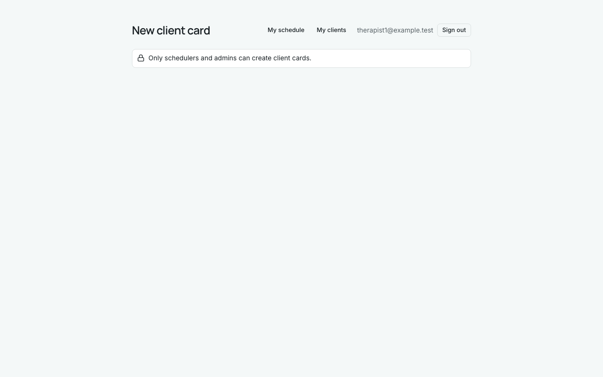
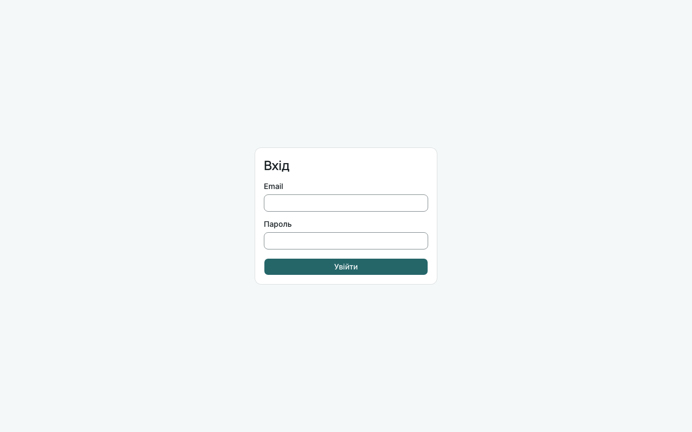
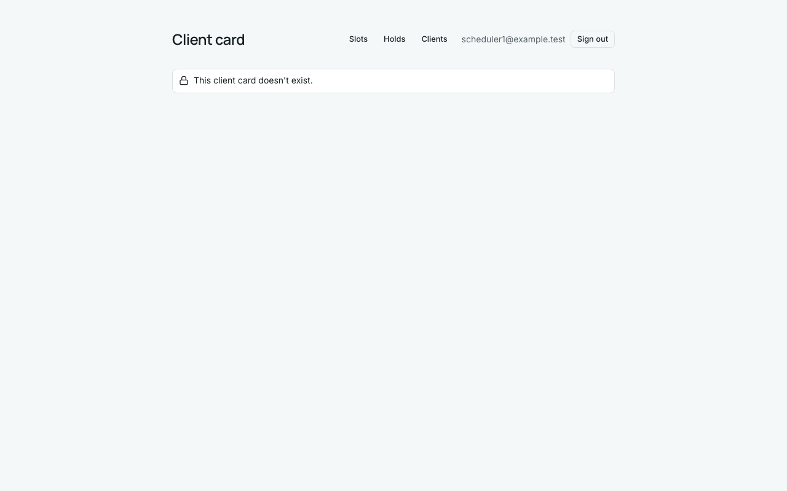
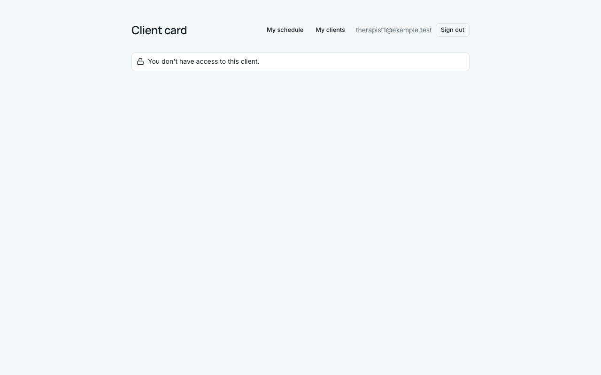
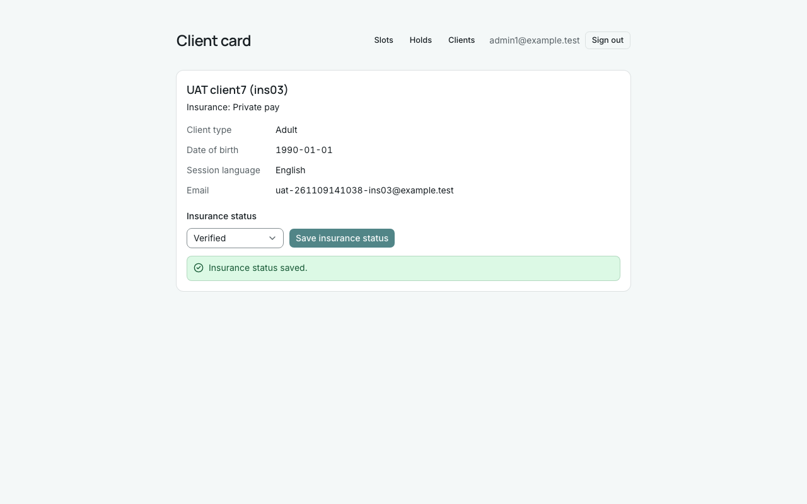
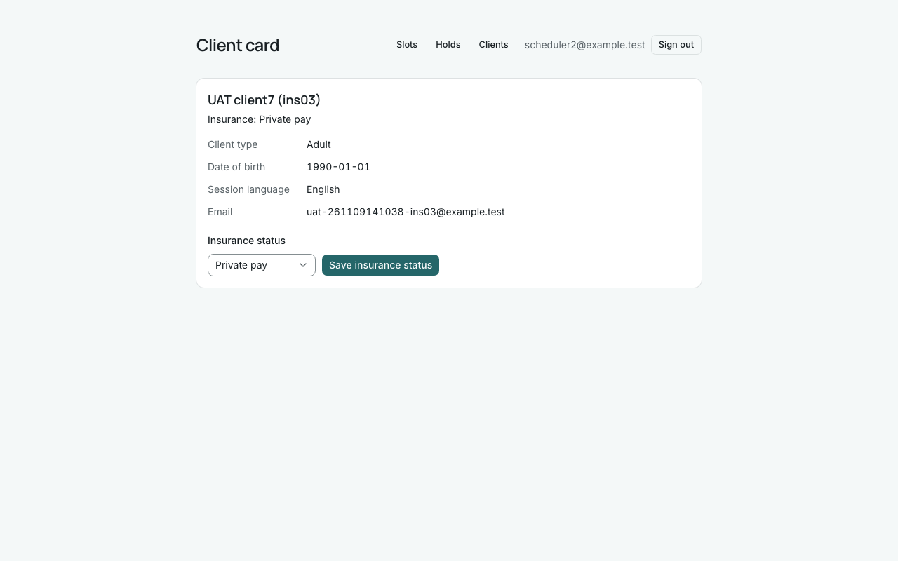
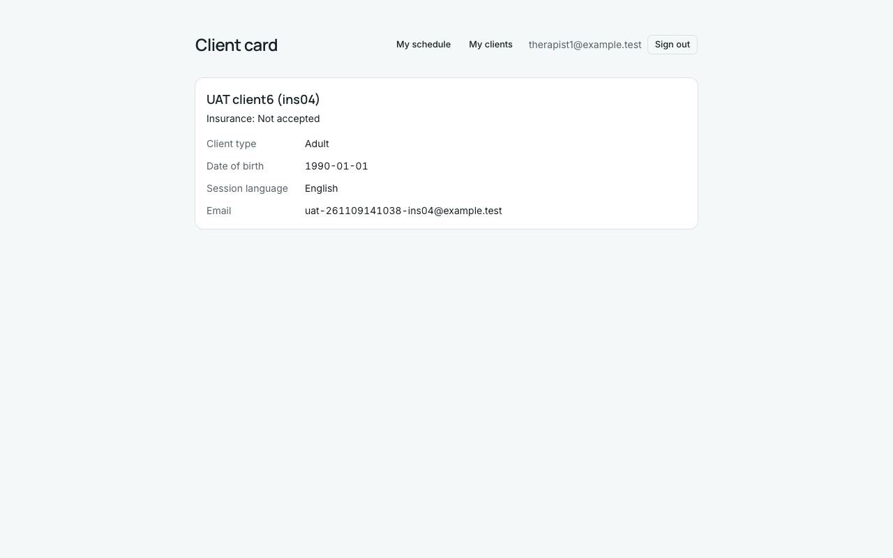
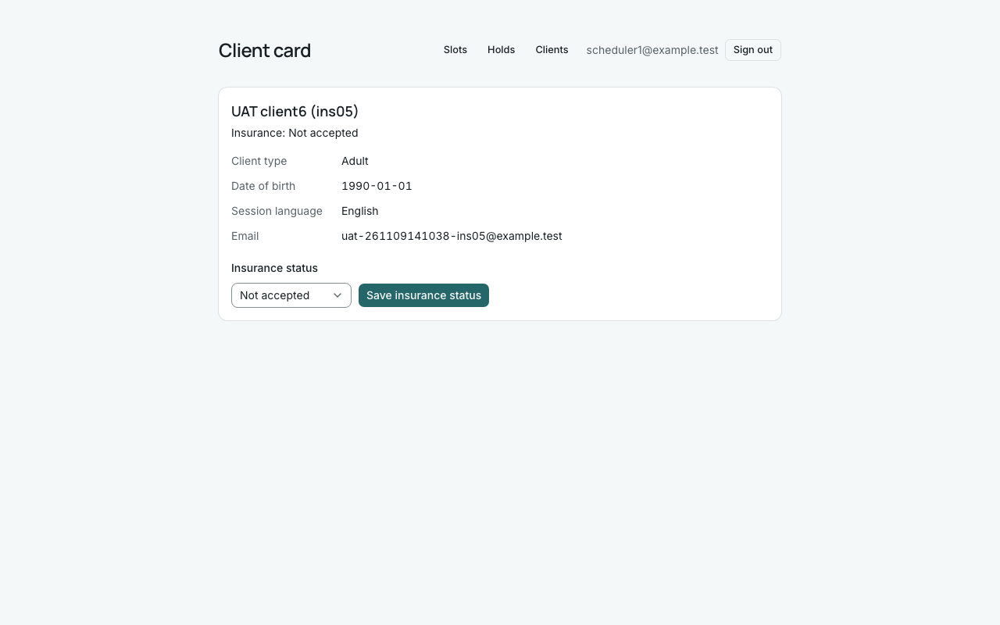

# Звіт UAT — 09.11.2026

- **Застосунок:** https://therapy-scheduling-three.vercel.app (/api/health: коміт `54c483b`)
- **Код тестів:** `task/uat-insurance-status` @ `fac8dab`
- **Прогін:** 09.11.2026, 16:10 (Київ), Playwright 64.0 с; AC: 9 — PASS 9, FAIL 0, NEEDS-HUMAN 0
- **Рецензент:** `claude-haiku-5-5`; суперечки → `claude-sonnet-5-5`. Разом за розбір: $0.0698 (ціни API; за підпискою — у межах ліміту плану)
- **Прибирання:** синтетичних uat-*@example.test видалено 6, лишилось 0, їхніх рядків, що лишились: 0
- **Відео й траси:** не в git — `test-results/` локально або артефакт CI; трасу відкриває `npx playwright show-trace <trace.zip>`

| AC | Перевірки | Агент | Підсумок | Чому | Playwright | Розбір |
|---|---|---|---|---|---|---|
| AC-CARD-06 | пройшли | Haiku: PASS | **PASS** | R6: перевірки, агент і цитати збігаються | 6.0 с | $0.0021, 6.2 с |
| AC-CARD-07 | пройшли | Haiku: PASS | **PASS** | R6: перевірки, агент і цитати збігаються | 9.2 с | $0.0034, 11.5 с |
| AC-CARD-16 | пройшли | Haiku: PASS | **PASS** | R6: перевірки, агент і цитати збігаються | 3.3 с | $0.0028, 9.8 с |
| AC-INS-01 | пройшли | Haiku: PASS | **PASS** | R6: перевірки, агент і цитати збігаються | 3.5 с | $0.0018, 5.9 с |
| AC-INS-02 | пройшли | Haiku: PASS | **PASS** | R6: перевірки, агент і цитати збігаються | 7.5 с | $0.0025, 9.3 с |
| AC-INS-03 | пройшли | Haiku: PASS | **PASS** | R6: перевірки, агент і цитати збігаються | 8.2 с | $0.0023, 8.1 с |
| AC-INS-04 | пройшли | Haiku: PASS | **PASS** | R6: перевірки, агент і цитати збігаються | 3.3 с | $0.0022, 12.6 с |
| AC-INS-05 | пройшли | Haiku: PASS | **PASS** | R6: перевірки, агент і цитати збігаються | 5.2 с | $0.0018, 6.3 с |
| AC-INS-06 | пройшли | Haiku: NEEDS-HUMAN, Sonnet: PASS | **PASS** | R6: перевірки, агент і цитати збігаються | 3.7 с | $0.0509, 22.3 с |

## AC-CARD-06 — PASS

**Тест:** AC-CARD-06: терапевт за прямим посиланням на нову картку бачить лише відмову, кількість карток не змінилась

**Критерій** (requirements/19-planuvalnyk-zapovniuie-kartku-kliienta.md):

> AC-CARD-06: Дано therapist1 увійшов у застосунок. Коли він відкриває форму нової картки клієнта за прямим посиланням. Тоді форму не показано, therapist1 одразу бачить повідомлення «Only schedulers and admins can create client cards.», і кількість карток клієнтів не змінилася.

**Кроки:** ✔ Дано: therapist1 увійшов у застосунок → ✔ Коли: він відкриває форму нової картки клієнта за прямим посиланням → ✔ Тоді: форму не показано, therapist1 одразу бачить повідомлення «Only schedulers and admins can create client cards.», і кількість карток клієнтів не змінилася

**Агент (claude-haiku-5-5, PASS):** На кадрі видно заголовок «New client card», під ним один рамковий блок із текстом «Only schedulers and admins can create client cards.» з іконкою замка. Полів анкети та кнопки створення на сторінці немає, сторінка порожня нижче блока. Текст збігається з критерієм посимвольно.

**Цитати агента, звірені зі сторінкою (aria):**
- «Only schedulers and admins can create client cards.» — є на сторінці
- «New client card» — є на сторінці
- «Only schedulers and admins can create client cards.» — є на сторінці

**Правило:** R6: перевірки, агент і цитати збігаються

**Відео:** `test-results/artifacts/client-cards-терапевт-AC-C-7cc32-лькість-карток-не-змінилась-chromium/video.webm` · **траса:** `test-results/artifacts/client-cards-терапевт-AC-C-7cc32-лькість-карток-не-змінилась-chromium/trace.zip` (не в git)

**Рішення PM:** ☐ приймаю · ☐ відхилення від вимог (issue «Відхилення від вимог: AC-CARD-06 — …») · @login: ____

## AC-CARD-07 — PASS

**Тест:** AC-CARD-07: без входу за прямим посиланням на клієнтів, картку client6 чи утримання — лише сторінка входу

**Критерій** (requirements/19-planuvalnyk-zapovniuie-kartku-kliienta.md):

> AC-CARD-07: Дано користувач не увійшов у застосунок. Коли він відкриває за прямим посиланням список клієнтів, картку client6 або список утримань. Тоді він бачить лише сторінку входу, жодних даних клієнтів чи утримань не показано, і жодна картка не змінилася.

**Кроки:** ✔ Дано: користувач не увійшов у застосунок → ✔ Коли: він відкриває за прямим посиланням список клієнтів → ✔ Тоді: він бачить лише сторінку входу, жодних даних клієнтів чи утримань не показано → ✔ Коли: він відкриває за прямим посиланням картку client6 → ✔ Тоді: він бачить лише сторінку входу, жодних даних клієнтів чи утримань не показано → ✔ Коли: він відкриває за прямим посиланням список утримань → ✔ Тоді: він бачить лише сторінку входу, жодних даних клієнтів чи утримань не показано, і жодна картка не змінилася

**Агент (claude-haiku-5-5, PASS):** На всіх трьох кадрах (після переходів за прямим посиланням до списку клієнтів, картки client6 і списку утримань) видно лише сторінку входу з заголовком «Вхід», полями Email і Пароль та кнопкою «Увійти»; жодних даних клієнтів чи утримань немає. Адресу /login, зміну карток і кількість карток не оцінював: за розділом «Не з кадрів» це перевіряють автоматичні перевірки.

**Цитати агента, звірені зі сторінкою (aria):**
- «Вхід» — є на сторінці
- «Email» — є на сторінці
- «Пароль» — є на сторінці
- «Вхід» — є на сторінці
- «Email» — є на сторінці
- «Пароль» — є на сторінці
- «Увійти» — є на сторінці
- «Вхід» — є на сторінці
- «Email» — є на сторінці
- «Пароль» — є на сторінці
- «Вхід» — є на сторінці
- «Email» — є на сторінці
- «Пароль» — є на сторінці
- «Увійти» — є на сторінці
- «Вхід» — є на сторінці
- «Email» — є на сторінці
- «Пароль» — є на сторінці
- «Вхід» — є на сторінці
- «Email» — є на сторінці
- «Пароль» — є на сторінці
- «Увійти» — є на сторінці

**Правило:** R6: перевірки, агент і цитати збігаються

**Відео:** `test-results/artifacts/client-cards-без-входу-AC--66889-мання-—-лише-сторінка-входу-chromium/video.webm` · **траса:** `test-results/artifacts/client-cards-без-входу-AC--66889-мання-—-лише-сторінка-входу-chromium/trace.zip` (не в git)

**Рішення PM:** ☐ приймаю · ☐ відхилення від вимог (issue «Відхилення від вимог: AC-CARD-07 — …») · @login: ____

## AC-CARD-16 — PASS

**Тест:** AC-CARD-16: посилання на картку, якої немає — scheduler1 бачить «This client card doesn't exist.», therapist1 — «You don't have access to this client.»

**Критерій** (requirements/19-planuvalnyk-zapovniuie-kartku-kliienta.md):

> AC-CARD-16: Дано картки клієнта, на яку веде посилання, не існує. Коли scheduler1, а потім therapist1 відкриває це посилання. Тоді scheduler1 бачить повідомлення «This client card doesn't exist.», therapist1 — «You don't have access to this client.», і жоден із них не бачить жодних даних клієнтів.

**Кроки:** ✔ Дано: картки клієнта, на яку веде посилання, не існує → ✔ Коли: scheduler1 відкриває це посилання → ✔ Тоді: scheduler1 бачить повідомлення «This client card doesn't exist.» → ✔ Коли: потім therapist1 відкриває це посилання → ✔ Тоді: therapist1 — «You don't have access to this client.», і жоден із них не бачить жодних даних клієнтів

**Агент (claude-haiku-5-5, PASS):** На frame-then-1 видно лише повідомлення «This client card doesn't exist.» із замком і навігацію (Slots, Holds, Clients, scheduler1@example.test); полів картки клієнта немає. На frame-then-2 видно лише «You don't have access to this client.» і навігацію (My schedule, My clients, therapist1@example.test); даних клієнта немає. Для частин про відсутність даних цитата — єдиний текст у блоці повідомлення, бо іншого вмісту картки на кадрі немає.

**Цитати агента, звірені зі сторінкою (aria):**
- «This client card doesn't exist.» — є на сторінці
- «This client card doesn't exist.» — є на сторінці
- «You don't have access to this client.» — є на сторінці
- «You don't have access to this client.» — є на сторінці

**Правило:** R6: перевірки, агент і цитати збігаються

**Відео:** `test-results/artifacts/client-cards-планувальник--08582-ave-access-to-this-client-»-chromium/video.webm` · **траса:** `test-results/artifacts/client-cards-планувальник--08582-ave-access-to-this-client-»-chromium/trace.zip` (не в git)

**Рішення PM:** ☐ приймаю · ☐ відхилення від вимог (issue «Відхилення від вимог: AC-CARD-16 — …») · @login: ____

## AC-INS-01 — PASS

**Тест:** AC-INS-01: нова картка, статус страхування ще ніхто не позначав — scheduler1 бачить «Insurance: Not set»

**Критерій** (requirements/33-planuvalnyk-status-perevirky-strakhuvannia.md):

> AC-INS-01: Дано картку client6 створено, і статус перевірки страхування ще ніхто не позначав. Коли scheduler1 відкриває картку client6. Тоді в картці показано «Insurance: Not set».

**Кроки:** ✔ Дано: картку client6 створено, і статус перевірки страхування ще ніхто не позначав → ✔ Коли: scheduler1 відкриває картку client6 → ✔ Тоді: в картці показано «Insurance: Not set»

**Агент (claude-haiku-5-5, PASS):** На кадрі frame-then-1.png картка «UAT client6 (ins01)» показує рядок «Insurance: Not set», а в шапці праворуч видно «scheduler1@example.test». Обидві видимі частини «Тоді» збігаються з критерієм посимвольно. Кадр чіткий, не обрізаний і без завантаження.

**Цитати агента, звірені зі сторінкою (aria):**
- «Insurance: Not set» — є на сторінці
- «scheduler1@example.test» — є на сторінці

**Правило:** R6: перевірки, агент і цитати збігаються

**Відео:** `test-results/artifacts/insurance-status-плануваль-20853--бачить-«Insurance-Not-set»-chromium/video.webm` · **траса:** `test-results/artifacts/insurance-status-плануваль-20853--бачить-«Insurance-Not-set»-chromium/trace.zip` (не в git)

**Рішення PM:** ☐ приймаю · ☐ відхилення від вимог (issue «Відхилення від вимог: AC-INS-01 — …») · @login: ____

## AC-INS-02 — PASS

**Тест:** AC-INS-02: scheduler1 позначає «Verified» — бачить «Insurance status saved.», картка показує «Insurance: Verified» і після повторного відкриття

**Критерій** (requirements/33-planuvalnyk-status-perevirky-strakhuvannia.md):

> AC-INS-02: Дано картка client6 показує «Insurance: Not set». Коли scheduler1 позначає статус перевірки страхування «Verified». Тоді scheduler1 бачить повідомлення «Insurance status saved.», а картка client6 показує «Insurance: Verified» і після того, як scheduler1 відкриє її знову.

**Кроки:** ✔ Дано: картка client6 показує «Insurance: Not set» → ✔ Коли: scheduler1 позначає статус перевірки страхування «Verified» → ✔ Тоді: scheduler1 бачить повідомлення «Insurance status saved.», а картка client6 показує «Insurance: Verified» → ✔ Коли: scheduler1 відкриває картку client6 знову → ✔ Тоді: картка client6 показує «Insurance: Verified» і після того, як scheduler1 відкриє її знову

**Агент (claude-haiku-5-5, PASS):** На frame-then-1 видно зелене повідомлення «Insurance status saved.», а в картці клієнта (UAT client6 (ins02)) рядок «Insurance: Verified»; у шапці — scheduler1@example.test. На frame-then-2 (сторінка картки без повідомлення про збереження) рядок «Insurance: Verified» і scheduler1@example.test також на місці. Повторне відкриття картки і запис у базі не оцінювалися, бо це «Не з кадрів».

**Цитати агента, звірені зі сторінкою (aria):**
- «Insurance status saved.» — є на сторінці
- «Insurance: Verified» — є на сторінці
- «scheduler1@example.test» — є на сторінці
- «Insurance: Verified» — є на сторінці
- «scheduler1@example.test» — є на сторінці

**Правило:** R6: перевірки, агент і цитати збігаються

**Відео:** `test-results/artifacts/insurance-status-плануваль-3cc22--після-повторного-відкриття-chromium/video.webm` · **траса:** `test-results/artifacts/insurance-status-плануваль-3cc22--після-повторного-відкриття-chromium/trace.zip` (не в git)

**Рішення PM:** ☐ приймаю · ☐ відхилення від вимог (issue «Відхилення від вимог: AC-INS-02 — …») · @login: ____

## AC-INS-03 — PASS

**Тест:** AC-INS-03: admin1 змінює статус на «Private pay» — і admin1, і scheduler2 бачать «Insurance: Private pay»

**Критерій** (requirements/33-planuvalnyk-status-perevirky-strakhuvannia.md):

> AC-INS-03: Дано картка client7 показує «Insurance: Verified». Коли admin1 змінює статус перевірки страхування на «Private pay», а потім scheduler2 відкриває картку client7. Тоді і admin1, і scheduler2 бачать у картці «Insurance: Private pay».

**Кроки:** ✔ Дано: картка client7 показує «Insurance: Verified» → ✔ Коли: admin1 змінює статус перевірки страхування на «Private pay» → ✔ Коли: а потім scheduler2 відкриває картку client7 → ✔ Тоді: і admin1, і scheduler2 бачать у картці «Insurance: Private pay» → ✔ Тоді: і admin1, і scheduler2 бачать у картці «Insurance: Private pay»

**Агент (claude-haiku-5-5, PASS):** На обох кадрах у заголовку картки «UAT client7 (ins03)» видно рядок «Insurance: Private pay». На кадрі 1 у шапці — admin1@example.test, на кадрі 2 — scheduler2@example.test, тобто обидва користувачі бачать очікуваний статус. Кадри чіткі, не обрізані; замазаних даних у межах перевірених частин немає.

**Цитати агента, звірені зі сторінкою (aria):**
- «Insurance: Private pay» — є на сторінці
- «admin1@example.test» — є на сторінці
- «Insurance: Private pay» — є на сторінці
- «scheduler2@example.test» — є на сторінці

**Правило:** R6: перевірки, агент і цитати збігаються

**Відео:** `test-results/artifacts/insurance-status-адміністр-a8df7-ать-«Insurance-Private-pay»-chromium/video.webm` · **траса:** `test-results/artifacts/insurance-status-адміністр-a8df7-ать-«Insurance-Private-pay»-chromium/trace.zip` (не в git)

**Рішення PM:** ☐ приймаю · ☐ відхилення від вимог (issue «Відхилення від вимог: AC-INS-03 — …») · @login: ____

## AC-INS-04 — PASS

**Тест:** AC-INS-04: therapist1 відкриває картку свого клієнта — бачить «Insurance: Not accepted», змінити статус не запропоновано

**Критерій** (requirements/33-planuvalnyk-status-perevirky-strakhuvannia.md):

> AC-INS-04: Дано client6 — свій клієнт therapist1, і картка client6 показує «Insurance: Not accepted». Коли therapist1 відкриває картку client6. Тоді він бачить «Insurance: Not accepted», а змінити статус перевірки страхування в картці йому не запропоновано.

**Кроки:** ✔ Дано: client6 — свій клієнт therapist1, і картка client6 показує «Insurance: Not accepted» → ✔ Коли: therapist1 відкриває картку client6 → ✔ Тоді: він бачить «Insurance: Not accepted», а змінити статус перевірки страхування в картці йому не запропоновано

**Агент (claude-haiku-5-5, PASS):** На кадрі сторінка «Client card» для «UAT client6 (ins04)» з рядком «Insurance: Not accepted» і шапкою therapist1@example.test. Під рядком статусу немає списку «Insurance status» і кнопки «Save insurance status», картка містить лише Client type, Date of birth, Session language та Email. Частина про відсутність елементів не має тексту для цитати, тому quoted_text порожній; це відсутність, а не текст, і кадр повний, без завантаження.

**Цитати агента, звірені зі сторінкою (aria):**
- «Insurance: Not accepted» — є на сторінці
- «therapist1@example.test» — є на сторінці

**Правило:** R6: перевірки, агент і цитати збігаються

**Відео:** `test-results/artifacts/insurance-status-терапевт--8b885-ити-статус-не-запропоновано-chromium/video.webm` · **траса:** `test-results/artifacts/insurance-status-терапевт--8b885-ити-статус-не-запропоновано-chromium/trace.zip` (не в git)

**Рішення PM:** ☐ приймаю · ☐ відхилення від вимог (issue «Відхилення від вимог: AC-INS-04 — …») · @login: ____

## AC-INS-05 — PASS

**Тест:** AC-INS-05: therapist1 напряму (Supabase REST) пробує змінити статус на «Verified» — статус не змінився, scheduler1 бачить «Insurance: Not accepted»

**Критерій** (requirements/33-planuvalnyk-status-perevirky-strakhuvannia.md):

> AC-INS-05: Дано client6 — свій клієнт therapist1, і картка client6 показує «Insurance: Not accepted». Коли therapist1 напряму, оминаючи сторінки застосунку, пробує змінити статус перевірки страхування client6 на «Verified». Тоді статус не змінився: scheduler1 у картці client6 бачить «Insurance: Not accepted».

**Кроки:** ✔ Дано: client6 — свій клієнт therapist1, і картка client6 показує «Insurance: Not accepted» → ✔ Коли: therapist1 напряму, оминаючи сторінки застосунку, пробує змінити статус перевірки страхування client6 на «Verified» → ✔ Коли: scheduler1 відкриває картку client6 → ✔ Тоді: статус не змінився: scheduler1 у картці client6 бачить «Insurance: Not accepted»

**Агент (claude-haiku-5-5, PASS):** На кадрі картка «UAT client6 (ins05)» показує «Insurance: Not accepted», а в шапці поруч із навігацією видно scheduler1@example.test. Обидві видимі частини «Тоді» підтверджено посимвольно. Частини щодо PATCH і статусу в базі не з кадрів, тому не оцінювалися.

**Цитати агента, звірені зі сторінкою (aria):**
- «Insurance: Not accepted» — є на сторінці
- «scheduler1@example.test» — є на сторінці

**Правило:** R6: перевірки, агент і цитати збігаються

**Відео:** `test-results/artifacts/insurance-status-терапевт--db25d-ть-«Insurance-Not-accepted»-chromium/video.webm` · **траса:** `test-results/artifacts/insurance-status-терапевт--db25d-ть-«Insurance-Not-accepted»-chromium/trace.zip` (не в git)

**Рішення PM:** ☐ приймаю · ☐ відхилення від вимог (issue «Відхилення від вимог: AC-INS-05 — …») · @login: ____

## AC-INS-06 — PASS

**Тест:** AC-INS-06: без входу за прямим посиланням на картку — лише сторінка входу, scheduler1 після цього бачить «Insurance: Verified»

**Критерій** (requirements/33-planuvalnyk-status-perevirky-strakhuvannia.md):

> AC-INS-06: Дано користувач не увійшов у застосунок, а картка client6 показує «Insurance: Verified». Коли він відкриває картку client6 за прямим посиланням. Тоді він бачить лише сторінку входу, статусу страхування й інших даних client6 не показано, а scheduler1 після цього бачить у картці client6 «Insurance: Verified».

**Кроки:** ✔ Дано: користувач не увійшов у застосунок, а картка client6 показує «Insurance: Verified» → ✔ Коли: він відкриває картку client6 за прямим посиланням → ✔ Тоді: він бачить лише сторінку входу, статусу страхування й інших даних client6 не показано → ✔ Коли: scheduler1 після цього відкриває картку client6 → ✔ Тоді: scheduler1 після цього бачить у картці client6 «Insurance: Verified»

**Агент (claude-sonnet-5-5, PASS):** Кадр 1 — лише форма входу (Вхід, Email, Пароль, кнопка Увійти) без рядка Insurance і даних клієнта. Кадр 2 — картка UAT client6 з «Insurance: Verified» і scheduler1@example.test у шапці.

Haiku сказав NEEDS-HUMAN, тож розбір повторив Sonnet; рішення агента — за Sonnet.

**Цитати агента, звірені зі сторінкою (aria):**
- «Вхід» — є на сторінці
- «Email» — є на сторінці
- «Пароль» — є на сторінці
- «Вхід» — є на сторінці
- «Email» — є на сторінці
- «Пароль» — є на сторінці
- «Увійти» — є на сторінці
- «Insurance: Verified» — є на сторінці
- «scheduler1@example.test» — є на сторінці

**Правило:** R6: перевірки, агент і цитати збігаються

**Відео:** `test-results/artifacts/insurance-status-без-входу-dcea2-бачить-«Insurance-Verified»-chromium/video.webm` · **траса:** `test-results/artifacts/insurance-status-без-входу-dcea2-бачить-«Insurance-Verified»-chromium/trace.zip` (не в git)

**Рішення PM:** ☐ приймаю · ☐ відхилення від вимог (issue «Відхилення від вимог: AC-INS-06 — …») · @login: ____

## Як читати підсумок

- **PASS** — автоматичні перевірки пройшли, агент-рецензент погодився з кадром, а кожну його цитату знайдено на сторінці.
- **FAIL** — впала автоматична перевірка. Агент цього не перекриває: невидимі вади (буфер обміну, база) він на кадрі не побачить.
- **NEEDS-HUMAN** — перевірки зелені, але агент не погодився або його цитати немає на сторінці. Часто це слабкий тест або розбіжність між текстом AC і тестом — питання до PM, а не обов'язково вада продукту.

Правила: R1: перевірка впала — FAIL завжди, агент не перекриває; R2: немає вердикту агента або кадру; R3: перевірки пройшли, агент не погоджується — вирішує людина; R4: цитати агента немає на сторінці (aria) — не підтверджено; R5: помилка сторінки або 5xx під час сценарію; R6: перевірки, агент і цитати збігаються.
