# Звіт UAT — 16.11.2026

- **Застосунок:** https://therapy-scheduling-three.vercel.app (/api/health: коміт `f96d3e7`)
- **Код тестів:** `task/consent-uat` @ `c173b95`
- **Прогін:** 16.11.2026, 23:44 (Київ), Playwright 147.4 с; AC: 22 — PASS 22, FAIL 0, NEEDS-HUMAN 0
- **Рецензент:** `claude-haiku-5-5`; суперечки → `claude-sonnet-5-5`. Разом за розбір: $0.0505 (ціни API; за підпискою — у межах ліміту плану)
- **Прибирання:** синтетичних uat-*@example.test видалено 17, лишилось 0, їхніх рядків, що лишились: 0
- **Відео й траси:** не в git — `test-results/` локально або артефакт CI; трасу відкриває `npx playwright show-trace <trace.zip>`

| AC | Перевірки | Агент | Підсумок | Чому | Playwright | Розбір |
|---|---|---|---|---|---|---|
| AC-CARD-06 | пройшли | Haiku: PASS | **PASS** | R6: перевірки, агент і цитати збігаються | 5.7 с | $0.0018, 6.2 с |
| AC-CARD-07 | пройшли | Haiku: PASS | **PASS** | R6: перевірки, агент і цитати збігаються | 9.7 с | $0.0035, 12.3 с |
| AC-CARD-16 | пройшли | Haiku: PASS | **PASS** | R6: перевірки, агент і цитати збігаються | 3.1 с | $0.0026, 9.2 с |
| AC-DOC-01 | пройшли | Haiku: PASS | **PASS** | R6: перевірки, агент і цитати збігаються | 3.9 с | $0.0019, 7.0 с |
| AC-DOC-02 | пройшли | Haiku: PASS | **PASS** | R6: перевірки, агент і цитати збігаються | 6.7 с | $0.0022, 8.6 с |
| AC-DOC-03 | пройшли | Haiku: PASS | **PASS** | R6: перевірки, агент і цитати збігаються | 6.1 с | $0.0019, 6.8 с |
| AC-DOC-04 | пройшли | Haiku: PASS | **PASS** | R6: перевірки, агент і цитати збігаються | 3.5 с | $0.0022, 8.7 с |
| AC-DOC-05 | пройшли | Haiku: PASS | **PASS** | R6: перевірки, агент і цитати збігаються | 6.3 с | $0.0024, 10.3 с |
| AC-DOC-06 | пройшли | Haiku: PASS | **PASS** | R6: перевірки, агент і цитати збігаються | 6.3 с | $0.0020, 7.1 с |
| AC-DOC-07 | пройшли | Haiku: PASS | **PASS** | R6: перевірки, агент і цитати збігаються | 7.0 с | $0.0019, 6.6 с |
| AC-DOC-08 | пройшли | Haiku: PASS | **PASS** | R6: перевірки, агент і цитати збігаються | 9.8 с | $0.0022, 8.8 с |
| AC-DOC-09 | пройшли | Haiku: PASS | **PASS** | R6: перевірки, агент і цитати збігаються | 5.6 с | $0.0033, 15.4 с |
| AC-DOC-10 | пройшли | Haiku: PASS | **PASS** | R6: перевірки, агент і цитати збігаються | 4.1 с | $0.0021, 10.2 с |
| AC-DOC-11 | пройшли | Haiku: PASS | **PASS** | R6: перевірки, агент і цитати збігаються | 2.4 с | $0.0019, 12.0 с |
| AC-INS-01 | пройшли | Haiku: PASS | **PASS** | R6: перевірки, агент і цитати збігаються | 3.2 с | $0.0018, 9.4 с |
| AC-INS-02 | пройшли | Haiku: PASS | **PASS** | R6: перевірки, агент і цитати збігаються | 8.0 с | $0.0027, 10.0 с |
| AC-INS-03 | пройшли | Haiku: PASS | **PASS** | R6: перевірки, агент і цитати збігаються | 7.5 с | $0.0025, 8.7 с |
| AC-INS-04 | пройшли | Haiku: PASS | **PASS** | R6: перевірки, агент і цитати збігаються | 4.2 с | $0.0021, 9.2 с |
| AC-INS-05 | пройшли | Haiku: PASS | **PASS** | R6: перевірки, агент і цитати збігаються | 5.8 с | $0.0019, 6.9 с |
| AC-INS-06 | пройшли | Haiku: PASS | **PASS** | R6: перевірки, агент і цитати збігаються | 4.8 с | $0.0035, 19.4 с |
| AC-INTAKE-03 | пройшли | Haiku: PASS | **PASS** | R6: перевірки, агент і цитати збігаються | 13.6 с | $0.0022, 9.8 с |
| AC-INTAKE-06 | пройшли | Haiku: PASS | **PASS** | R6: перевірки, агент і цитати збігаються | 7.6 с | $0.0019, 6.0 с |

## AC-CARD-06 — PASS

**Тест:** AC-CARD-06: терапевт за прямим посиланням на нову картку бачить лише відмову, кількість карток не змінилась

**Критерій** (requirements/19-planuvalnyk-zapovniuie-kartku-kliienta.md):

> AC-CARD-06: Дано therapist1 увійшов у застосунок. Коли він відкриває форму нової картки клієнта за прямим посиланням. Тоді форму не показано, therapist1 одразу бачить повідомлення «Only schedulers and admins can create client cards.», і кількість карток клієнтів не змінилася.

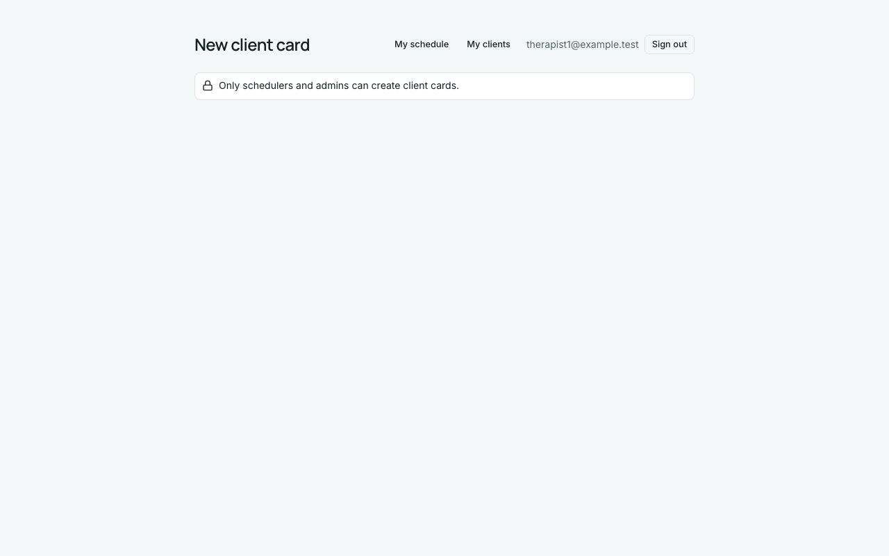

**Кроки:** ✔ Дано: therapist1 увійшов у застосунок → ✔ Коли: він відкриває форму нової картки клієнта за прямим посиланням → ✔ Тоді: форму не показано, therapist1 одразу бачить повідомлення «Only schedulers and admins can create client cards.», і кількість карток клієнтів не змінилася

**Агент (claude-haiku-5-5, PASS):** На кадрі видно заголовок «New client card», сірий блок із замком і текстом «Only schedulers and admins can create client cards.», а під ним порожня сторінка без полів анкети й кнопки створення. Текст повідомлення збігається з критерієм посимвольно. Частини «не з кадрів» (миттєвість відмови, незмінна кількість карток) не оцінював.

**Цитати агента, звірені зі сторінкою (aria):**
- «Only schedulers and admins can create client cards.» — є на сторінці
- «New client card» — є на сторінці
- «Only schedulers and admins can create client cards.» — є на сторінці

**Правило:** R6: перевірки, агент і цитати збігаються

**Відео:** `test-results/artifacts/client-cards-терапевт-AC-C-7cc32-лькість-карток-не-змінилась-chromium/video.webm` · **траса:** `test-results/artifacts/client-cards-терапевт-AC-C-7cc32-лькість-карток-не-змінилась-chromium/trace.zip` (не в git)

**Рішення PM:** ☐ приймаю · ☐ відхилення від вимог (issue «Відхилення від вимог: AC-CARD-06 — …») · @login: ____

## AC-CARD-07 — PASS

**Тест:** AC-CARD-07: без входу за прямим посиланням на клієнтів, картку client6 чи утримання — лише сторінка входу

**Критерій** (requirements/19-planuvalnyk-zapovniuie-kartku-kliienta.md):

> AC-CARD-07: Дано користувач не увійшов у застосунок. Коли він відкриває за прямим посиланням список клієнтів, картку client6 або список утримань. Тоді він бачить лише сторінку входу, жодних даних клієнтів чи утримань не показано, і жодна картка не змінилася.

**Кроки:** ✔ Дано: користувач не увійшов у застосунок → ✔ Коли: він відкриває за прямим посиланням список клієнтів → ✔ Тоді: він бачить лише сторінку входу, жодних даних клієнтів чи утримань не показано → ✔ Коли: він відкриває за прямим посиланням картку client6 → ✔ Тоді: він бачить лише сторінку входу, жодних даних клієнтів чи утримань не показано → ✔ Коли: він відкриває за прямим посиланням список утримань → ✔ Тоді: він бачить лише сторінку входу, жодних даних клієнтів чи утримань не показано, і жодна картка не змінилася

**Агент (claude-haiku-5-5, PASS):** На всіх трьох кадрах (frame-then-1, -2, -3) видно лише сторінку входу з заголовком «Вхід», полями Email і Пароль та кнопкою «Увійти»; жодних даних клієнтів чи утримань на кадрах немає. Частина «жодна картка не змінилася» (client6, scheduler1) і адреса /login не видні на кадрах, тому оцінені як cannot-tell і не впливають на вердикт.

**Цитати агента, звірені зі сторінкою (aria):**
- «Вхід» — є на сторінці
- «Email» — є на сторінці
- «Пароль» — є на сторінці
- «Вхід» — є на сторінці
- «Email» — є на сторінці
- «Пароль» — є на сторінці
- «Увійти» — є на сторінці
- «Вхід» — є на сторінці
- «Email» — є на сторінці
- «Пароль» — є на сторінці
- «Вхід» — є на сторінці
- «Email» — є на сторінці
- «Пароль» — є на сторінці
- «Увійти» — є на сторінці
- «Вхід» — є на сторінці
- «Email» — є на сторінці
- «Пароль» — є на сторінці
- «Вхід» — є на сторінці
- «Email» — є на сторінці
- «Пароль» — є на сторінці
- «Увійти» — є на сторінці

**Правило:** R6: перевірки, агент і цитати збігаються

**Відео:** `test-results/artifacts/client-cards-без-входу-AC--66889-мання-—-лише-сторінка-входу-chromium/video.webm` · **траса:** `test-results/artifacts/client-cards-без-входу-AC--66889-мання-—-лише-сторінка-входу-chromium/trace.zip` (не в git)

**Рішення PM:** ☐ приймаю · ☐ відхилення від вимог (issue «Відхилення від вимог: AC-CARD-07 — …») · @login: ____

## AC-CARD-16 — PASS

**Тест:** AC-CARD-16: посилання на картку, якої немає — scheduler1 бачить «This client card doesn't exist.», therapist1 — «You don't have access to this client.»

**Критерій** (requirements/19-planuvalnyk-zapovniuie-kartku-kliienta.md):

> AC-CARD-16: Дано картки клієнта, на яку веде посилання, не існує. Коли scheduler1, а потім therapist1 відкриває це посилання. Тоді scheduler1 бачить повідомлення «This client card doesn't exist.», therapist1 — «You don't have access to this client.», і жоден із них не бачить жодних даних клієнтів.

**Кроки:** ✔ Дано: картки клієнта, на яку веде посилання, не існує → ✔ Коли: scheduler1 відкриває це посилання → ✔ Тоді: scheduler1 бачить повідомлення «This client card doesn't exist.» → ✔ Коли: потім therapist1 відкриває це посилання → ✔ Тоді: therapist1 — «You don't have access to this client.», і жоден із них не бачить жодних даних клієнтів

**Агент (claude-haiku-5-5, PASS):** На frame-then-1.png (scheduler1) видно повідомлення «This client card doesn't exist.», на сторінці немає полів картки клієнта, лише заголовок «Client card» і навігація. На frame-then-2.png (therapist1) видно «You don't have access to this client.» і так само немає жодних даних клієнта. Частину про email (не з кадрів) не оцінював.

**Цитати агента, звірені зі сторінкою (aria):**
- «This client card doesn't exist.» — є на сторінці
- «Client card» — є на сторінці
- «This client card doesn't exist.» — є на сторінці
- «You don't have access to this client.» — є на сторінці
- «Client card» — є на сторінці
- «You don't have access to this client.» — є на сторінці

**Правило:** R6: перевірки, агент і цитати збігаються

**Відео:** `test-results/artifacts/client-cards-планувальник--08582-ave-access-to-this-client-»-chromium/video.webm` · **траса:** `test-results/artifacts/client-cards-планувальник--08582-ave-access-to-this-client-»-chromium/trace.zip` (не в git)

**Рішення PM:** ☐ приймаю · ☐ відхилення від вимог (issue «Відхилення від вимог: AC-CARD-16 — …») · @login: ____

## AC-DOC-01 — PASS

**Тест:** AC-DOC-01: картка client6 без документів згоди — «No consent documents yet.» і жодного документа

**Критерій** (requirements/34-planuvalnyk-formuie-dokumenty-zghody.md):

> AC-DOC-01: Дано картку client6 (тип «Adult») створено, і документів згоди для неї ще не формували. Коли scheduler1 відкриває картку client6. Тоді в картці показано повідомлення «No consent documents yet.» і жодного документа.

**Кроки:** ✔ Дано: картку client6 (тип «Adult») створено, і документів згоди для неї ще не формували → ✔ Коли: scheduler1 відкриває картку client6 → ✔ Тоді: в картці показано повідомлення «No consent documents yet.» і жодного документа

**Агент (claude-haiku-5-5, PASS):** На кадрі видно картку «UAT client6 (doc01)» з «Client type» — «Adult» і блок «Consent documents». У блоці є рядок «No consent documents yet.» та кнопка «Prepare consent documents», але жодного документа немає. Адресна строка на кадрі не видна, тому сам URL сторінки не перевірено; кадр читабельний і не обрізаний.

**Цитати агента, звірені зі сторінкою (aria):**
- «No consent documents yet.» — є на сторінці
- «No consent documents yet.» — є на сторінці

**Правило:** R6: перевірки, агент і цитати збігаються

**Відео:** `test-results/artifacts/consent-documents-планувал-75989-s-yet-»-і-жодного-документа-chromium/video.webm` · **траса:** `test-results/artifacts/consent-documents-планувал-75989-s-yet-»-і-жодного-документа-chromium/trace.zip` (не в git)

**Рішення PM:** ☐ приймаю · ☐ відхилення від вимог (issue «Відхилення від вимог: AC-DOC-01 — …») · @login: ____

## AC-DOC-02 — PASS

**Тест:** AC-DOC-02: scheduler1 формує документи для дорослого client6 — рівно два «Not signed» і «Missing signatures: …»

**Критерій** (requirements/34-planuvalnyk-formuie-dokumenty-zghody.md):

> AC-DOC-02: Дано для client6 (тип «Adult») документів згоди ще немає. Коли scheduler1 формує документи згоди для client6. Тоді в картці client6 показано рівно два документи — «Consent to treatment» і «Cancellation policy acknowledgement», кожен зі станом «Not signed», і рядок «Missing signatures: Consent to treatment, Cancellation policy acknowledgement».

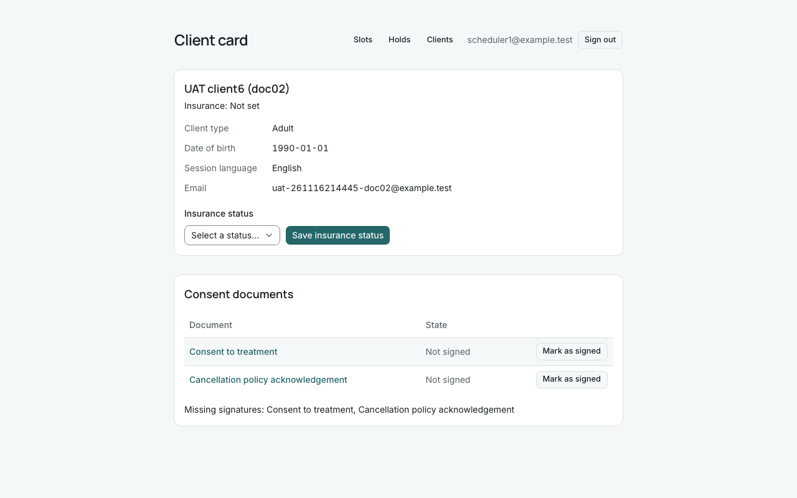

**Кроки:** ✔ Дано: для client6 (тип «Adult») документів згоди ще немає → ✔ Коли: scheduler1 формує документи згоди для client6 → ✔ Тоді: в картці client6 показано рівно два документи — «Consent to treatment» і «Cancellation policy acknowledgement», кожен зі станом «Not signed», і рядок «Missing signatures: Consent to treatment, Cancellation policy acknowledgement»

**Агент (claude-haiku-5-5, PASS):** На кадрі frame-then-1.png картка «UAT client6 (doc02)» з типом «Adult» показує саме два документи в таблиці «Consent documents»: «Consent to treatment» і «Cancellation policy acknowledgement», обидва зі станом «Not signed». Нижче видно рядок «Missing signatures: Consent to treatment, Cancellation policy acknowledgement», текст збігається з критерієм посимвольно. Кнопки «Mark as signed» не входять у критерій і не впливають на оцінку.

**Цитати агента, звірені зі сторінкою (aria):**
- «Consent to treatment» — є на сторінці
- «Not signed» — є на сторінці
- «Cancellation policy acknowledgement» — є на сторінці
- «Not signed» — є на сторінці
- «Missing signatures: Consent to treatment, Cancellation policy acknowledgement» — є на сторінці

**Правило:** R6: перевірки, агент і цитати збігаються

**Відео:** `test-results/artifacts/consent-documents-планувал-5beb6-d»-і-«Missing-signatures-…»-chromium/video.webm` · **траса:** `test-results/artifacts/consent-documents-планувал-5beb6-d»-і-«Missing-signatures-…»-chromium/trace.zip` (не в git)

**Рішення PM:** ☐ приймаю · ☐ відхилення від вимог (issue «Відхилення від вимог: AC-DOC-02 — …») · @login: ____

## AC-DOC-03 — PASS

**Тест:** AC-DOC-03: scheduler1 формує документи для дитини client7 з опікуном — рівно три «Not signed»

**Критерій** (requirements/34-planuvalnyk-formuie-dokumenty-zghody.md):

> AC-DOC-03: Дано для client7 (тип «Child», опікун «Guardian Seven») документів згоди ще немає. Коли scheduler1 формує документи згоди для client7. Тоді в картці client7 показано рівно три документи — «Consent to treatment», «Cancellation policy acknowledgement» і «Release of information», кожен зі станом «Not signed».

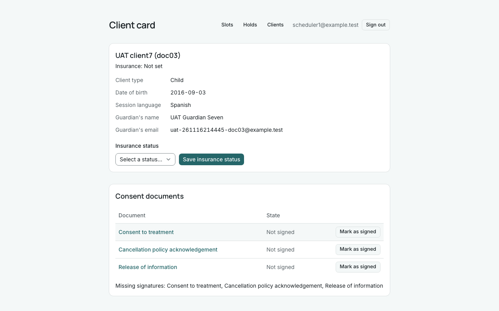

**Кроки:** ✔ Дано: для client7 (тип «Child», опікун «Guardian Seven») документів згоди ще немає → ✔ Коли: scheduler1 формує документи згоди для client7 → ✔ Тоді: в картці client7 показано рівно три документи — «Consent to treatment», «Cancellation policy acknowledgement» і «Release of information», кожен зі станом «Not signed»

**Агент (claude-haiku-5-5, PASS):** На кадрі в картці «UAT client7 (doc03)» у блоці «Consent documents» видно рівно три рядки: «Consent to treatment», «Cancellation policy acknowledgement» і «Release of information», кожен зі станом «Not signed». Кількість рядків (три) і написи збігаються з критерієм посимвольно; рядок «Missing signatures» під таблицею не суперечить умові. Перевірка «рівно три документи у базі» не з кадрів, тому не оцінювалась.

**Цитати агента, звірені зі сторінкою (aria):**
- «Consent to treatment» — є на сторінці
- «Not signed» — є на сторінці
- «Cancellation policy acknowledgement» — є на сторінці
- «Not signed» — є на сторінці
- «Release of information» — є на сторінці
- «Not signed» — є на сторінці

**Правило:** R6: перевірки, агент і цитати збігаються

**Відео:** `test-results/artifacts/consent-documents-планувал-385ca-ом-—-рівно-три-«Not-signed»-chromium/video.webm` · **траса:** `test-results/artifacts/consent-documents-планувал-385ca-ом-—-рівно-три-«Not-signed»-chromium/trace.zip` (не в git)

**Рішення PM:** ☐ приймаю · ☐ відхилення від вимог (issue «Відхилення від вимог: AC-DOC-03 — …») · @login: ____

## AC-DOC-04 — PASS

**Тест:** AC-DOC-04: scheduler1 відкриває «Release of information» client7 — заголовок, Client, Guardian, Prepared

**Критерій** (requirements/34-planuvalnyk-formuie-dokumenty-zghody.md):

> AC-DOC-04: Дано scheduler1 сформував документи згоди для client7 (тип «Child», ім'я «Client Seven», опікун «Guardian Seven») 2026-11-04. Коли scheduler1 відкриває документ «Release of information» client7. Тоді він бачить документ англійською із заголовком «Release of information», рядками «Client: Client Seven», «Guardian: Guardian Seven» і «Prepared: 2026-11-04».

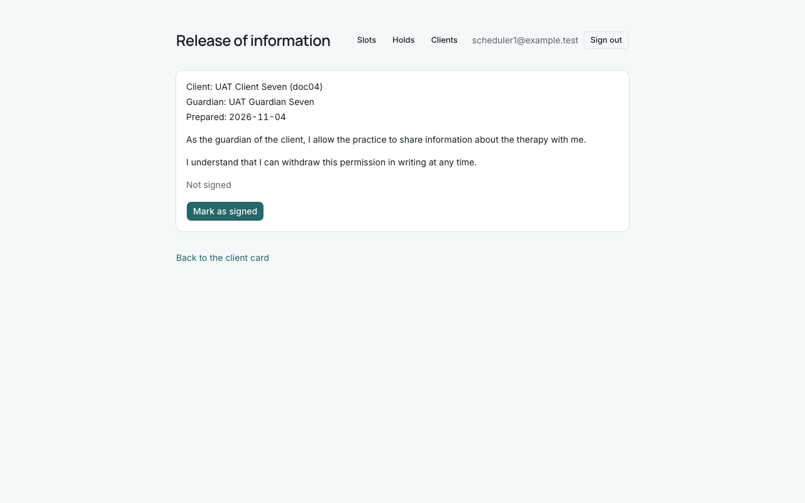

**Кроки:** ✔ Дано: scheduler1 сформував документи згоди для client7 (тип «Child», ім'я «Client Seven», опікун «Guardian Seven») 2026-11-04 → ✔ Коли: scheduler1 відкриває документ «Release of information» client7 → ✔ Тоді: він бачить документ англійською із заголовком «Release of information», рядками «Client: Client Seven», «Guardian: Guardian Seven» і «Prepared: 2026-11-04»

**Агент (claude-haiku-5-5, PASS):** На кадрі видно сторінку «Release of information» з рядками «Client: UAT Client Seven (doc04)», «Guardian: UAT Guardian Seven» і «Prepared: 2026-11-04», а також англійський текст згоди. Імена в рядках синтетичні, як зазначено в ac.md, тому їх не оцінюю; решта видимих частин збігаються з критерієм.

**Цитати агента, звірені зі сторінкою (aria):**
- «Release of information» — є на сторінці
- «Client: UAT Client Seven (doc04)» — є на сторінці
- «Guardian: UAT Guardian Seven» — є на сторінці
- «Prepared: 2026-11-04» — є на сторінці
- «As the guardian of the client, I allow the practice to share information about the therapy with me.» — є на сторінці
- «I understand that I can withdraw this permission in writing at any time.» — є на сторінці

**Правило:** R6: перевірки, агент і цитати збігаються

**Відео:** `test-results/artifacts/consent-documents-планувал-8119b-ок-Client-Guardian-Prepared-chromium/video.webm` · **траса:** `test-results/artifacts/consent-documents-планувал-8119b-ок-Client-Guardian-Prepared-chromium/trace.zip` (не в git)

**Рішення PM:** ☐ приймаю · ☐ відхилення від вимог (issue «Відхилення від вимог: AC-DOC-04 — …») · @login: ____

## AC-DOC-05 — PASS

**Тест:** AC-DOC-05: scheduler1 позначає «Consent to treatment» підписаним — «Signed …» і «Missing signatures: Cancellation policy acknowledgement»

**Критерій** (requirements/34-planuvalnyk-formuie-dokumenty-zghody.md):

> AC-DOC-05: Дано обидва документи згоди client6 мають стан «Not signed». Коли scheduler1 2026-11-04 о 10:15 позначає «Consent to treatment» підписаним. Тоді «Consent to treatment» показано зі станом «Signed 2026-11-04 10:15», а рядок у картці — «Missing signatures: Cancellation policy acknowledgement».

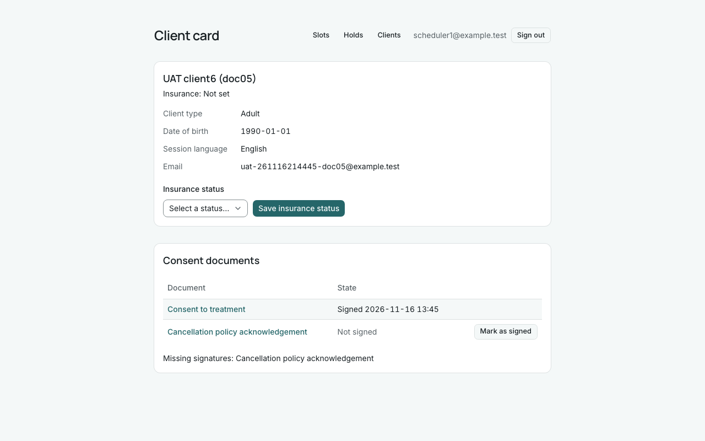

**Кроки:** ✔ Дано: обидва документи згоди client6 мають стан «Not signed» → ✔ Коли: scheduler1 позначає «Consent to treatment» підписаним → ✔ Тоді: «Consent to treatment» показано зі станом «Signed <дата> <час>», а рядок у картці — «Missing signatures: Cancellation policy acknowledgement»

**Агент (claude-haiku-5-5, PASS):** На кадрі видно картку client6 з двома документами: «Consent to treatment» має стан «Signed 2026-11-16 13:45», «Cancellation policy acknowledgement» — «Not signed», а під таблицею написано «Missing signatures: Cancellation policy acknowledgement». Дата в кадрі (2026-11-16) відрізняється від прикладу в PM (2026-11-04 10:15), але в критерії в «Тоді» стоїть плейсхолдер «<дата й час позначки>», тож формат відповідає; відповідність саме моменту позначки з кадрів не перевіряється.

**Цитати агента, звірені зі сторінкою (aria):**
- «Signed 2026-11-16 13:45» — є на сторінці
- «Not signed» — є на сторінці
- «Missing signatures: Cancellation policy acknowledgement» — є на сторінці

**Правило:** R6: перевірки, агент і цитати збігаються

**Відео:** `test-results/artifacts/consent-documents-планувал-a7f01-ion-policy-acknowledgement»-chromium/video.webm` · **траса:** `test-results/artifacts/consent-documents-планувал-a7f01-ion-policy-acknowledgement»-chromium/trace.zip` (не в git)

**Рішення PM:** ☐ приймаю · ☐ відхилення від вимог (issue «Відхилення від вимог: AC-DOC-05 — …») · @login: ____

## AC-DOC-06 — PASS

**Тест:** AC-DOC-06: scheduler2 позначає другий документ підписаним — обидва «Signed …», «All consent documents signed.»

**Критерій** (requirements/34-planuvalnyk-formuie-dokumenty-zghody.md):

> AC-DOC-06: Дано «Consent to treatment» client6 має стан «Signed», а «Cancellation policy acknowledgement» — «Not signed». Коли scheduler2 позначає «Cancellation policy acknowledgement» підписаним. Тоді обидва документи показано зі станом «Signed …», а замість рядка «Missing signatures» картка показує «All consent documents signed.».

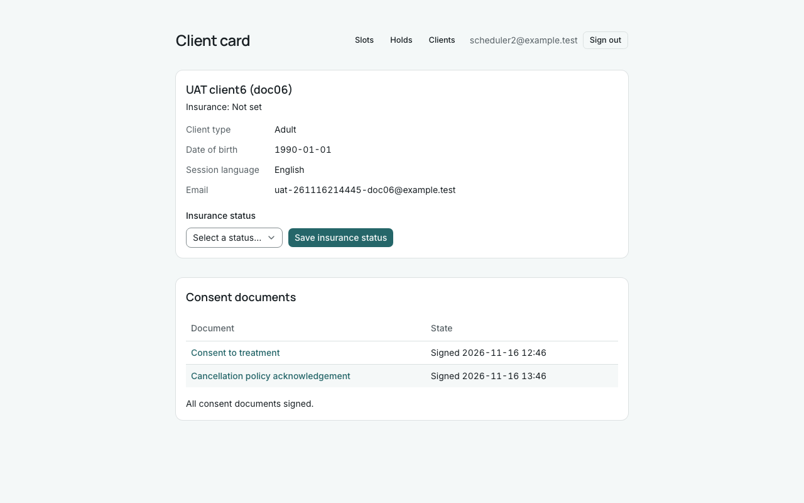

**Кроки:** ✔ Дано: «Consent to treatment» client6 має стан «Signed», а «Cancellation policy acknowledgement» — «Not signed» → ✔ Коли: scheduler2 позначає «Cancellation policy acknowledgement» підписаним → ✔ Тоді: обидва документи показано зі станом «Signed …», а замість рядка «Missing signatures» картка показує «All consent documents signed.»

**Агент (claude-haiku-5-5, PASS):** На кадрі обидва документи в таблиці «Consent documents» мають стан «Signed» з датою й часом: «Consent to treatment» — 2026-11-16 12:46, «Cancellation policy acknowledgement» — 2026-11-16 13:46. Під таблицею написано «All consent documents signed.», а рядка «Missing signatures» на кадрі немає. Сторінка повністю завантажена, текст читається без обрізання.

**Цитати агента, звірені зі сторінкою (aria):**
- «Signed 2026-11-16 12:46» — є на сторінці
- «Signed 2026-11-16 13:46» — є на сторінці
- «All consent documents signed.» — є на сторінці

**Правило:** R6: перевірки, агент і цитати збігаються

**Відео:** `test-results/artifacts/consent-documents-планувал-bc984--consent-documents-signed-»-chromium/video.webm` · **траса:** `test-results/artifacts/consent-documents-планувал-bc984--consent-documents-signed-»-chromium/trace.zip` (не в git)

**Рішення PM:** ☐ приймаю · ☐ відхилення від вимог (issue «Відхилення від вимог: AC-DOC-06 — …») · @login: ____

## AC-DOC-07 — PASS

**Тест:** AC-DOC-07: scheduler1 пробує підтвердити утримання client6 з непідписаним документом — «Sign all consent documents before confirming.», лишається «Held»

**Критерій** (requirements/34-planuvalnyk-formuie-dokumenty-zghody.md):

> AC-DOC-07: Дано client6 має утримання зі статусом «Held» у therapist1, для client6 сформовано документи згоди, і документ «Cancellation policy acknowledgement» має стан «Not signed». Коли scheduler1 пробує підтвердити це утримання. Тоді утримання не підтверджується, scheduler1 бачить повідомлення «Sign all consent documents before confirming.», а утримання лишається зі статусом «Held» і тим самим «Held until».

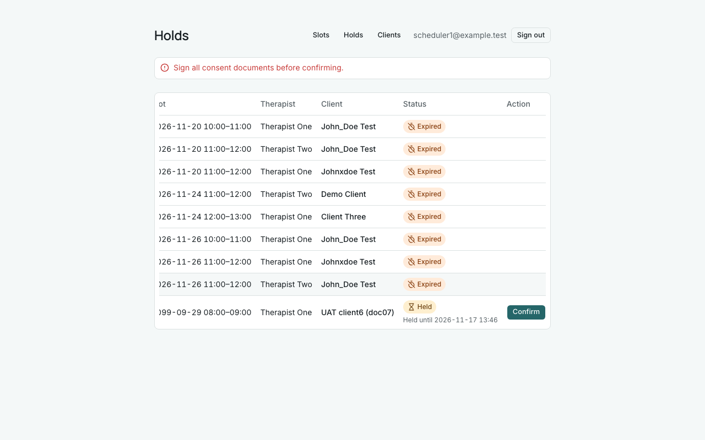

**Кроки:** ✔ Дано: client6 має утримання «Held» у therapist1, документи згоди сформовано, і «Cancellation policy acknowledgement» має стан «Not signed» → ✔ Коли: scheduler1 пробує підтвердити це утримання → ✔ Тоді: утримання не підтверджується, scheduler1 бачить повідомлення «Sign all consent documents before confirming.», а утримання лишається зі статусом «Held» і тим самим «Held until»

**Агент (claude-haiku-5-5, PASS):** На кадрі сторінки /holds видно червоне повідомлення «Sign all consent documents before confirming.» над таблицею. У рядку «UAT client6 (doc07)» (Therapist One) статус «Held», а під ним «Held until 2026-11-17 13:46», і кнопка «Confirm» ще доступна. Обидві видимі частини «Тоді» підтверджено дослівно.

**Цитати агента, звірені зі сторінкою (aria):**
- «Sign all consent documents before confirming.» — є на сторінці
- «Held» — є на сторінці
- «Held until 2026-11-17 13:46» — є на сторінці

**Правило:** R6: перевірки, агент і цитати збігаються

**Відео:** `test-results/artifacts/consent-documents-планувал-e9571-nfirming-»-лишається-«Held»-chromium/video.webm` · **траса:** `test-results/artifacts/consent-documents-планувал-e9571-nfirming-»-лишається-«Held»-chromium/trace.zip` (не в git)

**Рішення PM:** ☐ приймаю · ☐ відхилення від вимог (issue «Відхилення від вимог: AC-DOC-07 — …») · @login: ____

## AC-DOC-08 — PASS

**Тест:** AC-DOC-08: усі документи client6 підписано — scheduler1 підтверджує утримання, слот «Confirmed» без «Held until»

**Критерій** (requirements/34-planuvalnyk-formuie-dokumenty-zghody.md):

> AC-DOC-08: Дано client6 має утримання зі статусом «Held» у therapist1, утримання ще не прострочене й слот ще не почався, а всі документи згоди client6 мають стан «Signed». Коли scheduler1 підтверджує це утримання. Тоді слот має статус «Confirmed», а «Held until» більше не показано.

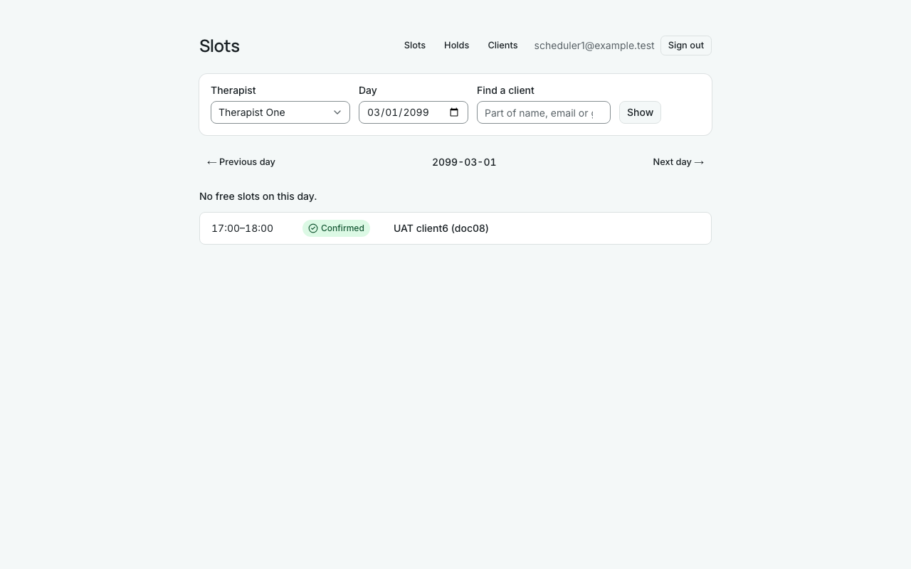

**Кроки:** ✔ Дано: client6 має утримання «Held» у therapist1, утримання ще не прострочене й слот ще не почався, а всі документи згоди мають стан «Signed» → ✔ Коли: scheduler1 підтверджує це утримання → ✔ Тоді: слот має статус «Confirmed», а «Held until» більше не показано

**Агент (claude-haiku-5-5, PASS):** На кадрі видно слот 17:00–18:00 у списку слотів therapist1 за 2099-03-01 зі значком «Confirmed» і написом «UAT client6 (doc08)». Жодного напису «Held until» у рядку слоту або поруч із ним немає. Частину про базу (confirmed_at) не оцінював, бо вона не з кадрів.

**Цитати агента, звірені зі сторінкою (aria):**
- «17:00–18:00» — є на сторінці
- «Confirmed» — є на сторінці
- «UAT client6 (doc08)» — є на сторінці
- «17:00–18:00» — є на сторінці
- «Confirmed» — є на сторінці
- «UAT client6 (doc08)» — є на сторінці

**Правило:** R6: перевірки, агент і цитати збігаються

**Відео:** `test-results/artifacts/consent-documents-планувал-b25ac-Confirmed»-без-«Held-until»-chromium/video.webm` · **траса:** `test-results/artifacts/consent-documents-планувал-b25ac-Confirmed»-без-«Held-until»-chromium/trace.zip` (не в git)

**Рішення PM:** ☐ приймаю · ☐ відхилення від вимог (issue «Відхилення від вимог: AC-DOC-08 — …») · @login: ____

## AC-DOC-09 — PASS

**Тест:** AC-DOC-09: therapist1 відкриває «Consent to treatment» свого client6 — бачить «Not signed», позначити не може

**Критерій** (requirements/34-planuvalnyk-formuie-dokumenty-zghody.md):

> AC-DOC-09: Дано client6 — свій клієнт therapist1, і документ «Consent to treatment» client6 має стан «Not signed». Коли therapist1 відкриває цей документ за прямим посиланням. Тоді він бачить документ і стан «Not signed», позначити його підписаним йому не запропоновано — замість цього він бачить повідомлення «Only schedulers and admins can mark documents as signed.», а scheduler1 після цього бачить у документа той самий стан «Not signed».

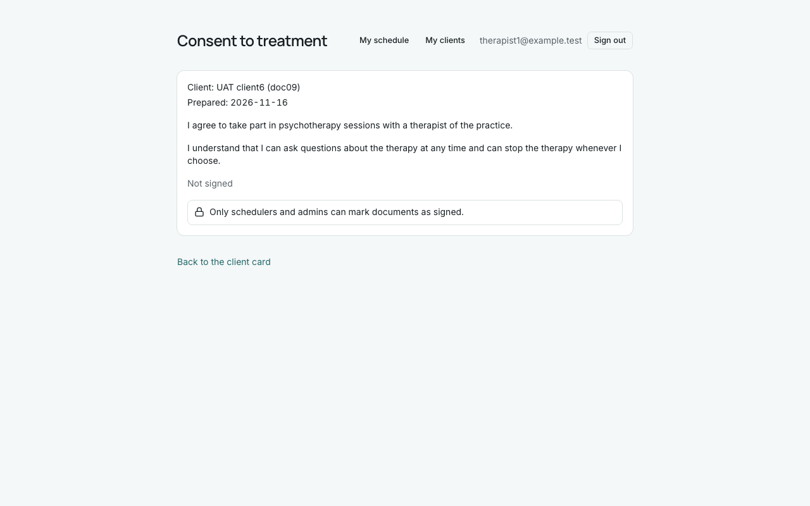
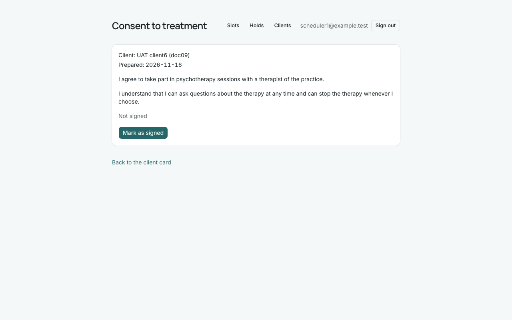

**Кроки:** ✔ Дано: client6 — свій клієнт therapist1, і документ «Consent to treatment» client6 має стан «Not signed» → ✔ Коли: therapist1 відкриває цей документ за прямим посиланням → ✔ Тоді: він бачить документ і стан «Not signed», позначити його підписаним йому не запропоновано — замість цього він бачить повідомлення «Only schedulers and admins can mark documents as signed.» → ✔ Тоді: scheduler1 після цього бачить у документа той самий стан «Not signed»

**Агент (claude-haiku-5-5, PASS):** На frame-then-1 для therapist1 (therapist1@example.test) видно документ «Consent to treatment» для UAT client6 (doc09) зі станом «Not signed», повідомлення «Only schedulers and admins can mark documents as signed.» і жодної кнопки «Mark as signed». На frame-then-2 для scheduler1@example.test той самий документ і стан «Not signed», а кнопка «Mark as signed» відображається. Відсутність кнопки на frame-then-1 підтверджена самим кадром, тому для цієї частини цитата порожня: це перевірка відсутності елемента, а не наявного тексту.

**Цитати агента, звірені зі сторінкою (aria):**
- «Consent to treatment» — є на сторінці
- «Not signed» — є на сторінці
- «Only schedulers and admins can mark documents as signed.» — є на сторінці
- «Consent to treatment» — є на сторінці
- «Not signed» — є на сторінці

**Правило:** R6: перевірки, агент і цитати збігаються

**Відео:** `test-results/artifacts/consent-documents-терапевт-19759-t-signed»-позначити-не-може-chromium/video.webm` · **траса:** `test-results/artifacts/consent-documents-терапевт-19759-t-signed»-позначити-не-може-chromium/trace.zip` (не в git)

**Рішення PM:** ☐ приймаю · ☐ відхилення від вимог (issue «Відхилення від вимог: AC-DOC-09 — …») · @login: ____

## AC-DOC-10 — PASS

**Тест:** AC-DOC-10: therapist1 відкриває документ client9 (свій лише для therapist2) — «You don't have access to this client.»

**Критерій** (requirements/34-planuvalnyk-formuie-dokumenty-zghody.md):

> AC-DOC-10: Дано client9 — свій клієнт лише для therapist2, і для client9 сформовано документи згоди. Коли therapist1 відкриває документ «Consent to treatment» client9 за прямим посиланням. Тоді therapist1 бачить повідомлення «You don't have access to this client.», жодного тексту документа чи даних client9 не показано, а стан документа не змінився.

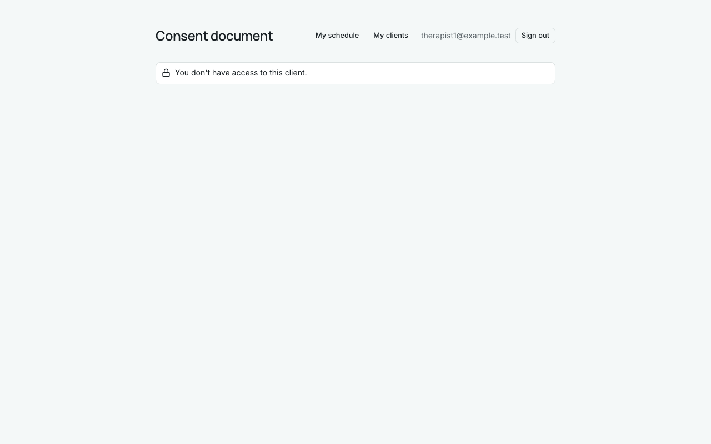

**Кроки:** ✔ Дано: client9 — свій клієнт лише для therapist2, і для client9 сформовано документи згоди → ✔ Коли: therapist1 відкриває документ «Consent to treatment» client9 за прямим посиланням → ✔ Тоді: therapist1 бачить повідомлення «You don't have access to this client.», жодного тексту документа чи даних client9 не показано, а стан документа не змінився

**Агент (claude-haiku-5-5, PASS):** На кадрі видно сторінку «Consent document» із навігацією (My schedule, My clients, therapist1@example.test, Sign out) і рядок із замком «You don't have access to this client.». Тексту згоди, назви клієнта чи його даних на кадрі немає. Цитата для другої частини — лише заголовок сторінки «Consent document», бо інших написів, крім навігації, немає. Стан документа в базі з кадру не видно, тож цю частину не оцінював.

**Цитати агента, звірені зі сторінкою (aria):**
- «You don't have access to this client.» — є на сторінці
- «Consent document» — є на сторінці

**Правило:** R6: перевірки, агент і цитати збігаються

**Відео:** `test-results/artifacts/consent-documents-терапевт-ff608-ave-access-to-this-client-»-chromium/video.webm` · **траса:** `test-results/artifacts/consent-documents-терапевт-ff608-ave-access-to-this-client-»-chromium/trace.zip` (не в git)

**Рішення PM:** ☐ приймаю · ☐ відхилення від вимог (issue «Відхилення від вимог: AC-DOC-10 — …») · @login: ____

## AC-DOC-11 — PASS

**Тест:** AC-DOC-11: без входу за прямим посиланням на «Consent to treatment» client6 — лише сторінка входу

**Критерій** (requirements/34-planuvalnyk-formuie-dokumenty-zghody.md):

> AC-DOC-11: Дано користувач не увійшов у застосунок, а для client6 сформовано документи згоди. Коли він відкриває документ «Consent to treatment» client6 за прямим посиланням. Тоді він бачить лише сторінку входу, тексту документа й даних client6 не показано, і стан документа не змінився.

**Кроки:** ✔ Дано: користувач не увійшов у застосунок, а для client6 сформовано документи згоди → ✔ Коли: він відкриває документ «Consent to treatment» client6 за прямим посиланням → ✔ Тоді: він бачить лише сторінку входу, тексту документа й даних client6 не показано, і стан документа не змінився

**Агент (claude-haiku-5-5, PASS):** На кадрі видно лише картку входу з заголовком «Вхід», полями «Email» і «Пароль» та кнопкою «Увійти» на порожньому фоні. Тексту документа «Consent to treatment» і даних client6 на екрані немає. Частину «стан документа не змінився» в ac.md віднесено до перевірок з бази, тому тут не оцінювалася.

**Цитати агента, звірені зі сторінкою (aria):**
- «Вхід» — є на сторінці
- «Email» — є на сторінці
- «Пароль» — є на сторінці
- «Увійти» — є на сторінці
- «Вхід» — є на сторінці
- «Email» — є на сторінці
- «Пароль» — є на сторінці
- «Увійти» — є на сторінці

**Правило:** R6: перевірки, агент і цитати збігаються

**Відео:** `test-results/artifacts/consent-documents-без-вход-08438-ient6-—-лише-сторінка-входу-chromium/video.webm` · **траса:** `test-results/artifacts/consent-documents-без-вход-08438-ient6-—-лише-сторінка-входу-chromium/trace.zip` (не в git)

**Рішення PM:** ☐ приймаю · ☐ відхилення від вимог (issue «Відхилення від вимог: AC-DOC-11 — …») · @login: ____

## AC-INS-01 — PASS

**Тест:** AC-INS-01: нова картка, статус страхування ще ніхто не позначав — scheduler1 бачить «Insurance: Not set»

**Критерій** (requirements/33-planuvalnyk-status-perevirky-strakhuvannia.md):

> AC-INS-01: Дано картку client6 створено, і статус перевірки страхування ще ніхто не позначав. Коли scheduler1 відкриває картку client6. Тоді в картці показано «Insurance: Not set».

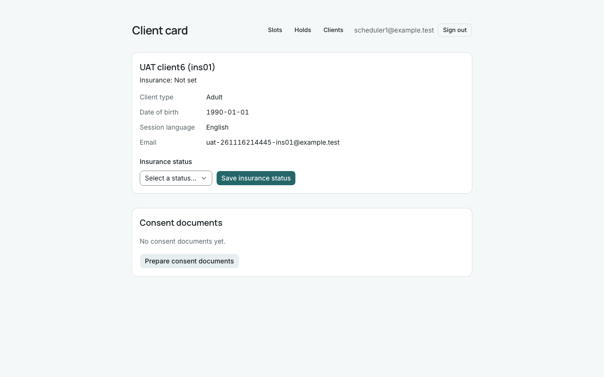

**Кроки:** ✔ Дано: картку client6 створено, і статус перевірки страхування ще ніхто не позначав → ✔ Коли: scheduler1 відкриває картку client6 → ✔ Тоді: в картці показано «Insurance: Not set»

**Агент (claude-haiku-5-5, PASS):** На кадрі frame-then-1.png під заголовком картки «UAT client6 (ins01)» чітко видно рядок «Insurance: Not set». У правому верхньому куті шапки видно «scheduler1@example.test» поруч із кнопкою «Sign out». Обидві видимі частини «Тоді» збігаються з критерієм посимвольно; кадр повний і читабельний.

**Цитати агента, звірені зі сторінкою (aria):**
- «Insurance: Not set» — є на сторінці
- «scheduler1@example.test» — є на сторінці

**Правило:** R6: перевірки, агент і цитати збігаються

**Відео:** `test-results/artifacts/insurance-status-плануваль-20853--бачить-«Insurance-Not-set»-chromium/video.webm` · **траса:** `test-results/artifacts/insurance-status-плануваль-20853--бачить-«Insurance-Not-set»-chromium/trace.zip` (не в git)

**Рішення PM:** ☐ приймаю · ☐ відхилення від вимог (issue «Відхилення від вимог: AC-INS-01 — …») · @login: ____

## AC-INS-02 — PASS

**Тест:** AC-INS-02: scheduler1 позначає «Verified» — бачить «Insurance status saved.», картка показує «Insurance: Verified» і після повторного відкриття

**Критерій** (requirements/33-planuvalnyk-status-perevirky-strakhuvannia.md):

> AC-INS-02: Дано картка client6 показує «Insurance: Not set». Коли scheduler1 позначає статус перевірки страхування «Verified». Тоді scheduler1 бачить повідомлення «Insurance status saved.», а картка client6 показує «Insurance: Verified» і після того, як scheduler1 відкриє її знову.

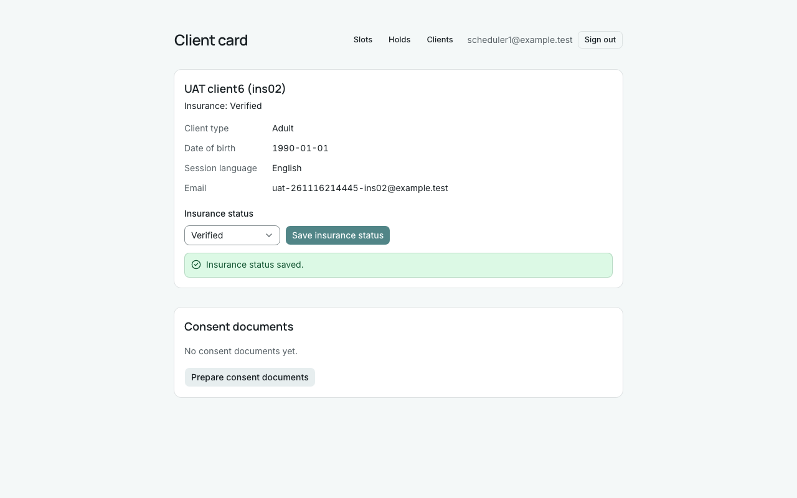

**Кроки:** ✔ Дано: картка client6 показує «Insurance: Not set» → ✔ Коли: scheduler1 позначає статус перевірки страхування «Verified» → ✔ Тоді: scheduler1 бачить повідомлення «Insurance status saved.», а картка client6 показує «Insurance: Verified» → ✔ Коли: scheduler1 відкриває картку client6 знову → ✔ Тоді: картка client6 показує «Insurance: Verified» і після того, як scheduler1 відкриє її знову

**Агент (claude-haiku-5-5, PASS):** На кадрі 1 видно повідомлення «Insurance status saved.», рядок «Insurance: Verified» і поле статусу зі значенням «Verified», у шапці scheduler1@example.test. На кадрі 2 (повторне відкриття) видно «Insurance: Verified» і той самий користувач у шапці; повідомлення про збереження відсутнє, що узгоджується з критерієм. Усі видимі частини «Тоді» підтверджені цитатами, розбіжностей у тексті немає.

**Цитати агента, звірені зі сторінкою (aria):**
- «Insurance status saved.» — є на сторінці
- «Insurance: Verified» — є на сторінці
- «Verified» — є на сторінці
- «scheduler1@example.test» — є на сторінці
- «Insurance: Verified» — є на сторінці
- «scheduler1@example.test» — є на сторінці

**Правило:** R6: перевірки, агент і цитати збігаються

**Відео:** `test-results/artifacts/insurance-status-плануваль-3cc22--після-повторного-відкриття-chromium/video.webm` · **траса:** `test-results/artifacts/insurance-status-плануваль-3cc22--після-повторного-відкриття-chromium/trace.zip` (не в git)

**Рішення PM:** ☐ приймаю · ☐ відхилення від вимог (issue «Відхилення від вимог: AC-INS-02 — …») · @login: ____

## AC-INS-03 — PASS

**Тест:** AC-INS-03: admin1 змінює статус на «Private pay» — і admin1, і scheduler2 бачать «Insurance: Private pay»

**Критерій** (requirements/33-planuvalnyk-status-perevirky-strakhuvannia.md):

> AC-INS-03: Дано картка client7 показує «Insurance: Verified». Коли admin1 змінює статус перевірки страхування на «Private pay», а потім scheduler2 відкриває картку client7. Тоді і admin1, і scheduler2 бачать у картці «Insurance: Private pay».

**Кроки:** ✔ Дано: картка client7 показує «Insurance: Verified» → ✔ Коли: admin1 змінює статус перевірки страхування на «Private pay» → ✔ Коли: а потім scheduler2 відкриває картку client7 → ✔ Тоді: і admin1, і scheduler2 бачать у картці «Insurance: Private pay» → ✔ Тоді: і admin1, і scheduler2 бачать у картці «Insurance: Private pay»

**Агент (claude-haiku-5-5, PASS):** На обох кадрах у картці «UAT client7 (ins03)» видно рядок «Insurance: Private pay». У шапці на першому кадрі показано admin1@example.test, на другому — scheduler2@example.test, тобто обидва користувачі бачать однаковий статус. Твердження про статус у базі та про походження картки не оцінювалися, бо це не видно з кадрів.

**Цитати агента, звірені зі сторінкою (aria):**
- «Insurance: Private pay» — є на сторінці
- «admin1@example.test» — є на сторінці
- «Insurance: Private pay» — є на сторінці
- «scheduler2@example.test» — є на сторінці

**Правило:** R6: перевірки, агент і цитати збігаються

**Відео:** `test-results/artifacts/insurance-status-адміністр-a8df7-ать-«Insurance-Private-pay»-chromium/video.webm` · **траса:** `test-results/artifacts/insurance-status-адміністр-a8df7-ать-«Insurance-Private-pay»-chromium/trace.zip` (не в git)

**Рішення PM:** ☐ приймаю · ☐ відхилення від вимог (issue «Відхилення від вимог: AC-INS-03 — …») · @login: ____

## AC-INS-04 — PASS

**Тест:** AC-INS-04: therapist1 відкриває картку свого клієнта — бачить «Insurance: Not accepted», змінити статус не запропоновано

**Критерій** (requirements/33-planuvalnyk-status-perevirky-strakhuvannia.md):

> AC-INS-04: Дано client6 — свій клієнт therapist1, і картка client6 показує «Insurance: Not accepted». Коли therapist1 відкриває картку client6. Тоді він бачить «Insurance: Not accepted», а змінити статус перевірки страхування в картці йому не запропоновано.

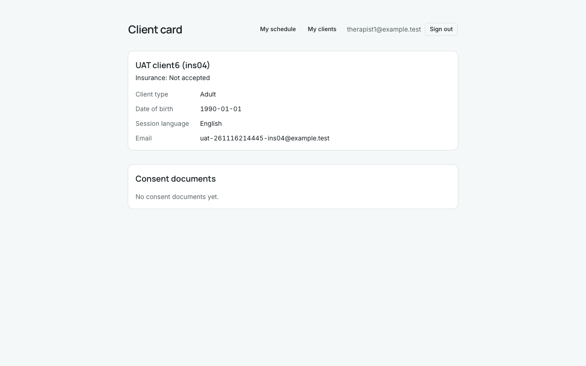

**Кроки:** ✔ Дано: client6 — свій клієнт therapist1, і картка client6 показує «Insurance: Not accepted» → ✔ Коли: therapist1 відкриває картку client6 → ✔ Тоді: він бачить «Insurance: Not accepted», а змінити статус перевірки страхування в картці йому не запропоновано

**Агент (claude-haiku-5-5, PASS):** Кадр повний: картка клієнта і блок «Consent documents» видно цілком, сторінка не обрізана й не в стані завантаження. На кадрі є «Insurance: Not accepted» і шапка з therapist1@example.test, а блоку «Insurance status» і кнопки «Save insurance status» немає. Частину про відсутність форми на сторінці з кадрів не оцінював, у ac.md її віднесено до автоматичних перевірок.

**Цитати агента, звірені зі сторінкою (aria):**
- «Insurance: Not accepted» — є на сторінці
- «therapist1@example.test» — є на сторінці

**Правило:** R6: перевірки, агент і цитати збігаються

**Відео:** `test-results/artifacts/insurance-status-терапевт--8b885-ити-статус-не-запропоновано-chromium/video.webm` · **траса:** `test-results/artifacts/insurance-status-терапевт--8b885-ити-статус-не-запропоновано-chromium/trace.zip` (не в git)

**Рішення PM:** ☐ приймаю · ☐ відхилення від вимог (issue «Відхилення від вимог: AC-INS-04 — …») · @login: ____

## AC-INS-05 — PASS

**Тест:** AC-INS-05: therapist1 напряму (Supabase REST) пробує змінити статус на «Verified» — статус не змінився, scheduler1 бачить «Insurance: Not accepted»

**Критерій** (requirements/33-planuvalnyk-status-perevirky-strakhuvannia.md):

> AC-INS-05: Дано client6 — свій клієнт therapist1, і картка client6 показує «Insurance: Not accepted». Коли therapist1 напряму, оминаючи сторінки застосунку, пробує змінити статус перевірки страхування client6 на «Verified». Тоді статус не змінився: scheduler1 у картці client6 бачить «Insurance: Not accepted».

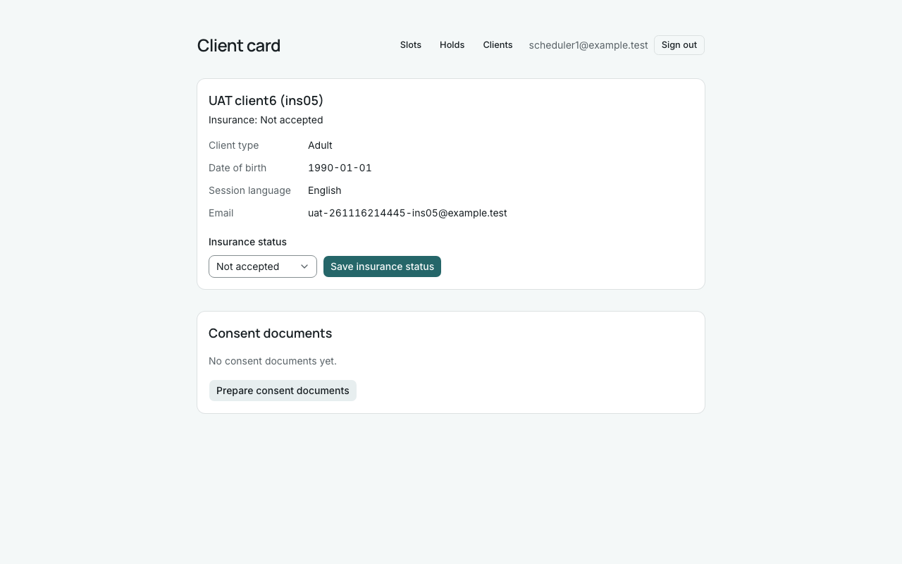

**Кроки:** ✔ Дано: client6 — свій клієнт therapist1, і картка client6 показує «Insurance: Not accepted» → ✔ Коли: therapist1 напряму, оминаючи сторінки застосунку, пробує змінити статус перевірки страхування client6 на «Verified» → ✔ Коли: scheduler1 відкриває картку client6 → ✔ Тоді: статус не змінився: scheduler1 у картці client6 бачить «Insurance: Not accepted»

**Агент (claude-haiku-5-5, PASS):** На кадрі картки client6 (UAT client6 (ins05)) у шапці видно «Insurance: Not accepted», а в правому верхньому куті — користувач scheduler1@example.test; селект статусу також показує «Not accepted». Обидві видимі частини «Тоді» підтверджені дослівно. Частини про PATCH-відповідь і запис у базі не з кадрів, тому не оцінювалися.

**Цитати агента, звірені зі сторінкою (aria):**
- «Insurance: Not accepted» — є на сторінці
- «scheduler1@example.test» — є на сторінці

**Правило:** R6: перевірки, агент і цитати збігаються

**Відео:** `test-results/artifacts/insurance-status-терапевт--db25d-ть-«Insurance-Not-accepted»-chromium/video.webm` · **траса:** `test-results/artifacts/insurance-status-терапевт--db25d-ть-«Insurance-Not-accepted»-chromium/trace.zip` (не в git)

**Рішення PM:** ☐ приймаю · ☐ відхилення від вимог (issue «Відхилення від вимог: AC-INS-05 — …») · @login: ____

## AC-INS-06 — PASS

**Тест:** AC-INS-06: без входу за прямим посиланням на картку — лише сторінка входу, scheduler1 після цього бачить «Insurance: Verified»

**Критерій** (requirements/33-planuvalnyk-status-perevirky-strakhuvannia.md):

> AC-INS-06: Дано користувач не увійшов у застосунок, а картка client6 показує «Insurance: Verified». Коли він відкриває картку client6 за прямим посиланням. Тоді він бачить лише сторінку входу, статусу страхування й інших даних client6 не показано, а scheduler1 після цього бачить у картці client6 «Insurance: Verified».

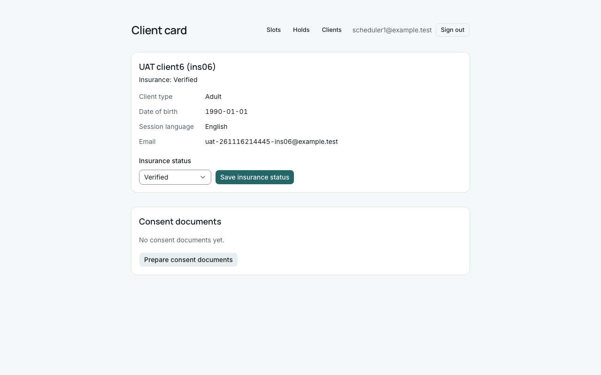

**Кроки:** ✔ Дано: користувач не увійшов у застосунок, а картка client6 показує «Insurance: Verified» → ✔ Коли: він відкриває картку client6 за прямим посиланням → ✔ Тоді: він бачить лише сторінку входу, статусу страхування й інших даних client6 не показано → ✔ Коли: scheduler1 після цього відкриває картку client6 → ✔ Тоді: scheduler1 після цього бачить у картці client6 «Insurance: Verified»

**Агент (claude-haiku-5-5, PASS):** Кадр frame-then-1.png показує лише сторінку «Вхід» з полями Email і Пароль і кнопкою «Увійти»; рядка Insurance і даних client6 на екрані немає. Частина «жодних даних клієнта не показано» підтверджується відсутністю, тому цитати немає. Кадр frame-then-2.png показує картку «UAT client6 (ins06)» з рядком «Insurance: Verified» і в шапці «scheduler1@example.test», тож після входу scheduler1 бачить статус. Адресу /login, відсутність email @example.test на сторінці та статус verified у базі не оцінював, бо вони не з кадрів.

**Цитати агента, звірені зі сторінкою (aria):**
- «Вхід» — є на сторінці
- «Email» — є на сторінці
- «Пароль» — є на сторінці
- «Insurance: Verified» — є на сторінці
- «scheduler1@example.test» — є на сторінці

**Правило:** R6: перевірки, агент і цитати збігаються

**Відео:** `test-results/artifacts/insurance-status-без-входу-dcea2-бачить-«Insurance-Verified»-chromium/video.webm` · **траса:** `test-results/artifacts/insurance-status-без-входу-dcea2-бачить-«Insurance-Verified»-chromium/trace.zip` (не в git)

**Рішення PM:** ☐ приймаю · ☐ відхилення від вимог (issue «Відхилення від вимог: AC-INS-06 — …») · @login: ____

## AC-INTAKE-03 — PASS

**Тест:** AC-INTAKE-03: чернетку Client Ten заповнено у формі, scheduler1 не створює картку — у списку клієнтів її немає

**Критерій** (requirements/36-planuvalnyk-chernetka-kartky-kliienta.md):

> AC-INTAKE-03: Дано чернетку за текстом з AC-INTAKE-01 заповнено у формі нової картки. Коли scheduler1 не створює картку й відкриває список клієнтів. Тоді картки «Client Ten» у списку немає: картку створює лише сам планувальник, коли зберігає форму.

**Кроки:** ✔ Дано: чернетку за текстом з AC-INTAKE-01 заповнено у формі нової картки → ✔ Коли: scheduler1 не створює картку й відкриває список клієнтів → ✔ Тоді: картки «Client Ten» у списку немає: картку створює лише сам планувальник, коли зберігає форму

**Агент (claude-haiku-5-5, PASS):** На кадрі сторінка Clients, увійшов scheduler1@example.test. У полі пошуку введено «Client Ten», а під ним написано «No clients found.», тобто рядків немає. Результат видно лише для пошуку, а не для повного списку; email цього прогону на кадрі не показано. Частини про кількість карток і пошук за email не з кадрів, тому я їх не оцінював.

**Цитати агента, звірені зі сторінкою (aria):**
- «Clients» — є на сторінці
- «scheduler1@example.test» — є на сторінці
- «No clients found.» — є на сторінці

**Правило:** R6: перевірки, агент і цитати збігаються

**Відео:** `test-results/artifacts/client-intake-draft-планув-b4dc7--у-списку-клієнтів-її-немає-chromium/video.webm` · **траса:** `test-results/artifacts/client-intake-draft-планув-b4dc7--у-списку-клієнтів-її-немає-chromium/trace.zip` (не в git)

**Рішення PM:** ☐ приймаю · ☐ відхилення від вимог (issue «Відхилення від вимог: AC-INTAKE-03 — …») · @login: ____

## AC-INTAKE-06 — PASS

**Тест:** AC-INTAKE-06: текст не є зверненням нового клієнта — поля форми не змінено (Name лишається «Client Fifteen»)

**Критерій** (requirements/36-planuvalnyk-chernetka-kartky-kliienta.md):

> AC-INTAKE-06: Дано у формі нової картки вже введено Name «Client Fifteen». Коли scheduler1 просить скласти чернетку з тексту звернення «Can you recommend a good book about anxiety?». Тоді поля форми не змінено (Name лишається «Client Fifteen»), і scheduler1 бачить повідомлення «This text can't be used to draft a client card. Paste the client's request or fill in the form manually.»

**Кроки:** ✔ Дано: у формі нової картки вже введено Name «Client Fifteen» → ✔ Коли: scheduler1 просить скласти чернетку з тексту звернення «Can you recommend a good book about anxiety?» → ✔ Тоді: поля форми не змінено (Name лишається «Client Fifteen»), і scheduler1 бачить повідомлення «This text can't be used to draft a client card. Paste the client's request or fill in the form manually.»

**Агент (claude-haiku-5-5, PASS):** На кадрі frame-then-1.png сторінка /clients/new з повідомленням під кнопкою «Draft from request» і полем Name зі значенням «Client Fifteen». Текст повідомлення збігається з критерієм посимвольно. Частини з розділу «Не з кадрів» (Client type, порожні поля, відсутність створеної картки) не оцінювалися.

**Цитати агента, звірені зі сторінкою (aria):**
- «This text can't be used to draft a client card. Paste the client's request or fill in the form manually.» — є на сторінці
- «Client Fifteen» — є на сторінці

**Правило:** R6: перевірки, агент і цитати збігаються

**Відео:** `test-results/artifacts/client-intake-draft-планув-3462f-лишається-«Client-Fifteen»--chromium/video.webm` · **траса:** `test-results/artifacts/client-intake-draft-планув-3462f-лишається-«Client-Fifteen»--chromium/trace.zip` (не в git)

**Рішення PM:** ☐ приймаю · ☐ відхилення від вимог (issue «Відхилення від вимог: AC-INTAKE-06 — …») · @login: ____

## Як читати підсумок

- **PASS** — автоматичні перевірки пройшли, агент-рецензент погодився з кадром, а кожну його цитату знайдено на сторінці.
- **FAIL** — впала автоматична перевірка. Агент цього не перекриває: невидимі вади (буфер обміну, база) він на кадрі не побачить.
- **NEEDS-HUMAN** — перевірки зелені, але агент не погодився або його цитати немає на сторінці. Часто це слабкий тест або розбіжність між текстом AC і тестом — питання до PM, а не обов'язково вада продукту.

Правила: R1: перевірка впала — FAIL завжди, агент не перекриває; R2: немає вердикту агента або кадру; R3: перевірки пройшли, агент не погоджується — вирішує людина; R4: цитати агента немає на сторінці (aria) — не підтверджено; R5: помилка сторінки або 5xx під час сценарію; R6: перевірки, агент і цитати збігаються.
